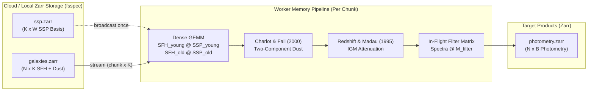

# specsynth: Cloud-Native Distributed Infrastructure for Survey-Scale Astrophysical Spectral Synthesis

[](https://sankarganeshb.github.io/specsynth/)
[](https://github.com/SankarGaneshb/specsynth/actions)
[](https://codecov.io/gh/SankarGaneshb/specsynth)
[](https://huggingface.co/datasets/sreeganesh/specsynth-benchmark-100k)
[](https://doi.org/10.57967/hf/11635)
[](https://colab.research.google.com/github/SankarGaneshb/specsynth/blob/main/notebooks/quickstart.ipynb)
[](https://www.kaggle.com/code/bsankarganesh/specsynth-gpu-benchmark)
[](https://opensource.org/licenses/MIT)
[](https://www.python.org/)

`specsynth` is an open-source distributed framework for scalable stellar population synthesis (SPS) and in-flight photometric forward-modeling of cosmological galaxy catalogs. By coupling chunked **Zarr** storage via `fsspec` with **Dask** distributed task graphs and optional **CuPy** GPU tensor contractions, `specsynth` streams galaxy star formation histories (SFHs) from local disks or cloud object stores, contracts them against Simple Stellar Population (SSP) spectral grids in worker cache/VRAM, and projects them directly into broadband photometry without materializing multi-terabyte intermediate spectra onto disk.

**Full Documentation & API Reference:** [https://sankarganeshb.github.io/specsynth/](https://sankarganeshb.github.io/specsynth/) (source under [`docs/`](docs/)).

---

## 1. Installation & Quickstart

### Install

```bash
git clone https://github.com/SankarGaneshb/specsynth.git
cd specsynth
python -m venv .venv
# Linux/macOS: source .venv/bin/activate
# Windows:     .\.venv\Scripts\Activate.ps1
pip install -e ".[astro,test]"
```

Optional extras: `.[storage]` (`s3fs`, `gcsfs`, `adlfs`), `.[gpu]` (`cupy-cuda12x`), `.[docs]` (`mkdocs`, `mkdocs-material`, `mkdocstrings`). See the [Installation Guide](docs/getting-started/installation.md) for details.

### Run an End-to-End Pipeline

```bash
# 1. Compile an SSP basis into Zarr (swap --adapter toy for bc03, emiles, fsps, or fits)
specsynth --base ./run1 --scheduler sync make-ssp --adapter toy --n-age 40 --n-met 4 --n-wave 2000

# 2. Generate a mock galaxy catalog (or use `import-catalog` for Parquet/FITS/HDF5/CSV)
specsynth --base ./run1 --scheduler sync make-sfh --n-gal 20000 --chunk 5000

# 3. Synthesize JWST NIRCam photometry in-flight at z = 2.0 with Madau (1995) IGM attenuation
specsynth --base ./run1 --scheduler sync synth --filters jwst_nircam --redshift 2.0 --igm

# 4. Verify float32 distributed output against an independent float64 reference
specsynth --base ./run1 --scheduler sync verify --sample 200
```

Run the automated test suite and cross-code astrophysical validation:

```bash
pytest -v
python scripts/cross_validate_sps.py --n-gal 500
```

### TNG → JWST NIRCam Scientific Validation & Demonstration (Milestone 1)

For researchers evaluating synthetic JWST NIRCam photometry from cosmological simulations (IllustrisTNG-100) using FSPS:

- **Interactive Jupyter Notebook (< 5s CPU evaluation)**:
  ```bash
  jupyter lab notebooks/tng-jwst/01_tng_jwst_synthetic_photometry.ipynb
  ```
  *Executes in **~2.04 seconds** on a single CPU core without external Fortran compiler prerequisites, generating 5 publication-ready figures.*

- **Automated End-to-End Validation Pipeline**:
  ```bash
  python scripts/validate_tng_jwst.py
  ```
  *Executes all 6 validation stages, validating STScI NIRCam filter checksums, in-flight GEMM synthesis ($1{,}510\,\mathrm{gal/s}$), C09 scientific catalog export, and double-precision stability ($\max \delta F/F = 4.77 \times 10^{-8}$).*

---

## 2. System Architecture & Worker Pipeline

`specsynth` decouples offline SSP basis construction (`K x W`) from online streaming matrix contractions (`N_chunk x K` @ `K x W`). Intermediate full spectra stay in CPU cache or GPU VRAM and are projected directly into photometric bandpasses (`W x B`):



For each galaxy $g$, composite stellar flux is modeled with Charlot & Fall (2000) two-component dust attenuation:

$$F_g(\lambda) = D_g(\lambda) \cdot \left[ \sum_{k \in \text{old}} \text{SFH}[g,k]\,\text{SSP}[k,\lambda] + B_g(\lambda)\sum_{k \in \text{young}} \text{SFH}[g,k]\,\text{SSP}[k,\lambda] \right]$$

---

## 3. Core Capabilities

| Capability | Summary | Documentation |
| :--- | :--- | :--- |
| **SSP Library Adapters** | Bruzual & Charlot (2003) `.ised`/ASCII, E-MILES/MILES FITS, FSPS (`python-fsps` & `spstot_*.spec`), BPASS v2.2+, generic 3D FITS/HDF5/NPZ | [SSP Adapters Guide](docs/guides/adapters.md) |
| **Catalog Ingestion** | Native Parquet, FITS, HDF5, CSV (streaming), and NPZ ingestion for IllustrisTNG, EAGLE, CAMELS, and SAM catalogs | [Catalogs & Photometry](docs/guides/catalogs-and-photometry.md) |
| **Cosmology & Filters** | `FlatLambdaCDM` (default Concordance $H_0=70.0$, $\Omega_m=0.3$, Planck 2018/2015, or custom), Snapshot & Lightcone modes, Madau (1995) IGM, 16 calibrated JWST, HST, and SDSS filters | [Catalogs & Photometry](docs/guides/catalogs-and-photometry.md) |
| **Distributed & GPU Scaling** | Dask (`sync`, `threads`, `local`, Kubernetes), `--batch-chunks` scheduler guard, `s3://`/`gs://`/`abfs://`, CuPy CUDA BLAS | [Distributed & GPU Guide](docs/guides/distributed-and-gpu.md) |
| **Scientific Validation** | Cross-validation against Astropy cosmology, float64 reference, optional live `python-fsps`/`DSPS`, and 4-tier Scientific Sentry QA | [Validation & Benchmarks](docs/guides/validation-and-benchmarks.md) |

---

## 4. Empirical Verification Summary

All headline benchmarks below are empirically measured and recorded in machine-readable JSON manifests under [`paper/`](paper/):

- **Numerical Accuracy**: Max relative spectral error `9.87e-7` (RMSE `2.24e-11`) against an independent `float64` reference (`paper/benchmark_manifest.json`).
- **TNG → JWST NIRCam Scientific Validation**: Max relative error `4.77e-8` (RMSE `5.59e-23`), $0.000\,\mathrm{mag}$ AB zero-point deviation, and $1{,}510.5\,\mathrm{gal/s}$ CPU throughput over the curated 100-galaxy TNG-100 sample (`paper/benchmark_manifest_tng_jwst.json`).
- **Single-Node CPU vs. GPU**: `57,978 gal/s` on a 12-core workstation CPU (`scipy-openblas`). On an NVIDIA Tesla T4 GPU via CuPy, `specsynth` sustains `258,812 gal/s` end-to-end throughput (**4.51x speedup** relative to the paired cloud VM CPU baseline at `57,344 gal/s`, including host-device transfers; `paper/benchmark_manifest_gpu_t4.json`).
- **Memory Boundedness**: Single-process sequential chunk RSS stays flat at `261.5–261.8 MB` (< 0.2% variance) while streaming 100,000 to 1,000,000 galaxies in 20,000-galaxy chunks.
- **Multi-Node Kubernetes**: `53,814 gal/s` on a 3-node OCI OKE cluster backed by in-cluster shared NFS (100,000 galaxies in `1.86 s`, max rel. error `8.16e-7`, `paper/benchmark_manifest_oci_oke_3node.json`).
- **Projected Cluster Scaling**: Analytical scaling models estimate throughput of $> 1.5 \times 10^6\,\mathrm{gal/s}$ across 32 distributed workers ($10^8$ galaxies in $\sim 1.1\,\mathrm{min}$, $\approx \$0.01$ spot compute; clearly distinguished from empirical measurements).

See the full [Validation & Benchmarks Guide](docs/guides/validation-and-benchmarks.md) for reproduction commands and detailed tables.

---

## 5. Canonical Reference Benchmark Dataset

A 100,000-galaxy lightcone benchmark catalog ($z \in [0.05, 3.8]$, 16 calibrated JWST/HST/SDSS bands in float64) is archived on Hugging Face with permanent DOI [`10.57967/hf/11635`](https://doi.org/10.57967/hf/11635):

```python
from datasets import load_dataset
ds = load_dataset("sreeganesh/specsynth-benchmark-100k")
```

---

## 6. Contributing, Code of Conduct & License

- **Contributing**: See [CONTRIBUTING.md](CONTRIBUTING.md) and open a [GitHub Issue](https://github.com/SankarGaneshb/specsynth/issues) or Pull Request.
- **Code of Conduct**: Governed by the [Contributor Covenant v2.1](CODE_OF_CONDUCT.md).
- **Citation**: See [CITATION.cff](CITATION.cff) for software citation metadata.
- **License**: Released under the [MIT License](LICENSE).
