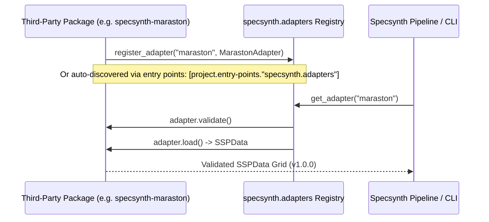

# ADR-001: Scope Freeze and Versioned Architectural Contracts

- **Status:** Accepted (Scope Freeze Ratified)
- **Date:** 2026-11-26
- **Context:** Milestone P0 (Issue #14) — `[MUST][P0]` Scope and Architecture Freeze
- **Target Goal:** *"An independent astrophysicist should be able to plug their own simulation, galaxy-modelling, or spectral-synthesis engine into the Specsynth ecosystem; generate scientifically reproducible 3D galaxy models and synthetic observations; interactively explore galaxies across cosmic time; and make these capabilities accessible through MCP — without modifying the core framework."*

---

## 1. Product Responsibilities & Boundaries (P0.1)

To prevent scope creep and architectural entanglement, product responsibilities are strictly separated:

```mermaid
flowchart LR
    subgraph Specsynth["Specsynth (Scientific Compute Framework)"]
        direction TB
        S1["Engine Adapters (FSPS, BC03, Custom)"]
        S2["In-Flight GEMM Matrix Contraction"]
        S3["Physics Invariants (Dust, IGM, Distance)"]
        S4["Scientific Sentry QA & Provenance"]
        S5["Python MCP Server (specsynth-mcp)"]
    end

    subgraph Perandam["PerandamΨ (Interactive Research Environment)"]
        direction TB
        P1["Interactive 3D Stage (Lightcone / Multi-Galaxy)"]
        P2["Cosmic-Time Timeline & Evolutionary Lineage"]
        P3["In-Browser Forward-Modeling Parameter Sweep"]
        P4["JWST Proposal Feasibility Planner"]
        P5["Node.js MCP Server (perandam-psi-mcp)"]
    end

    Specsynth <-->|"Versioned JSON-RPC / MCP stdio / Zarr"| Perandam
```

- **Specsynth Core Responsibility:**
  - Python-based distributed scientific engine (Dask, Zarr, CuPy/BLAS).
  - Versioned input ingestion and simulation snapshot parsing.
  - Physical invariant enforcement (mass conservation, flux conservation, Madau 1995 IGM, Charlot & Fall 2000 dust).
  - Calibrated STScI filter transmission integration and synthetic photometry calculation.
  - Sentry 4-tier diagnostic auditing and cryptographic provenance manifest generation.
  - Canonical Python Model Context Protocol (MCP) server.

- **PerandamΨ Responsibility:**
  - High-performance, WebGL-accelerated interactive research interface.
  - Multi-scale 3D galaxy exploration across cosmic time ($z \in [0.1, 10+]$).
  - Client-side responsive forward-modeling parameter sweeps ($\Delta z, \Delta A_V$).
  - Rest-frame vs observed-frame SED visualization with instrument bandpass overlays.
  - Standalone Node.js MCP server providing protocol-level parity.

- **Boundary Enforcement:**
  - The UI never mutates core SPS algorithms.
  - The core engine never imports frontend components or browser-specific libraries.
  - Data exchanged between systems strictly adheres to versioned schemas (`specsynth.contracts`).

---

## 2. Versioned Engine Input/Output Contracts (P0.2)

All pipeline data structures are standardized under `specsynth.contracts` with semver `1.0.0`:

| Contract | Module | Key Attributes & Requirements | Standard Units |
|---|---|---|---|
| **`SSPGridContract`** | `specsynth.contracts.ssp` | Strictly ascending `ages_yr`, `mets_z`, `wave_angstrom`; 2D array of shape $(N_{\text{age}} \times N_{\text{met}}, N_{\text{wave}})$ in age-major layout; non-negative. | $L_\odot/\text{Å}$ per $M_\odot$ formed |
| **`SimulationGalaxyContract`** | `specsynth.contracts.simulation` | Physical parameters: `stellar_mass_msun`, `sfr_msun_per_yr`, `metallicity_mass_fraction`, `tau_diffuse`, `tau_birth`, `sfh_onset_gyr`, `sfh_tau_gyr`. | $M_\odot$, $M_\odot/\text{yr}$, mass fraction $Z$, Gyr |
| **`SyntheticObservationContract`** | `specsynth.contracts.photometry` | Synthetic multi-band flux densities, monochromatic AB magnitudes, 10 ks ETC noise errors, $S/N$, and rest/observed SED arrays. | $\mu\text{Jy}$, AB mag, $\text{erg}\,\text{s}^{-1}\text{cm}^{-2}\text{Å}^{-1}$ |

---

## 3. External Engine Adapter Interface & Lifecycle (P0.3)

To fulfill **Pillar 1 (Zero-Core-Modification Pluggability)**, external simulation, galaxy-modelling, and SPS engines plug into Specsynth without modifying a single line of core framework code:

- **Lifecycle Phases:**
  1. `validate()`: Confirms binary/data prerequisites are met on worker nodes.
  2. `get_capabilities()`: Declares supported ages, metallicities, wavelengths, IMF options, and limitations.
  3. `load()`: Loads raw tables/grids and constructs normalized `SSPData`.
  4. `resample_wavelength()`: Linearly projects onto standard telescope wavelength grids.
- **Discovery Mechanism:**
  - Manual runtime registration: `register_adapter("name", AdapterClass)`.
  - Zero-touch automated discovery via standard Python entry points under group `specsynth.adapters`.

---

## 4. Scientific 3D Galaxy Data Model & Conventions (P0.4)

Enforces strict physical rigor and provenance for 3D visualizations:

1. **Coordinate Systems:**
   - **`physical_rest`**: Origin at galaxy center of mass; spatial coordinates in physical $\text{kpc}$; aligned with angular momentum vector $\vec{J}$; velocities in $\text{km/s}$.
   - **`comoving_box`**: Simulation box coordinates in comoving $\text{ckpc}/h$; $r_{\text{phys}} = r_{\text{comov}} / (1 + z)$.
   - **`observer_sky`**: Celestial Right Ascension $\alpha$, Declination $\delta$ in degrees (ICRS J2000), line-of-sight comoving distance $D_C(z)$ in $\text{Mpc}$.

2. **Particle Typing:**
   - Standard components: `star` (type 4), `gas` (type 0), `dark_matter` (type 1), `black_hole` (type 5).
   - Stars require coordinates, velocities, masses ($M_\odot$), stellar ages ($\text{yr}$), and metallicities ($Z$).

3. **Truth in Labeling Rule:**
   - Any model synthesized from actual particle snapshots must declare `geometry_source: "simulation_derived"` with snapshot number and subhalo ID.
   - Any synthetic procedural rendering must declare `geometry_source: "procedural_illustrative"`. **Procedural geometry must never be presented as empirical simulation data.**

---

## 5. Canonical MCP Tool Contracts & Protocol Parity (P0.5)

Both the Python (`specsynth.mcp`) and Node.js (`perandam-psi/mcp_server.mjs`) servers expose identical tool signatures under the unified canonical naming standard:

| Canonical MCP Tool | Purpose & Annotations | Python Handler | Node Handler |
|---|---|---|---|
| `specsynth_list_filters` | List all calibrated instrument filters (`readOnly`, `idempotent`) | `server._tool_list_filters` | `psi_get_catalog_info` (filters) |
| `specsynth_inspect_galaxy` | Extract physical parameters, SFH, and synthetic SED (`readOnly`, `idempotent`) | `server._tool_inspect_galaxy` | `psi_inspect_galaxy` |
| `specsynth_calculate_cosmology` | Flat $\Lambda\text{CDM}$ distance measures ($D_L, D_C, D_A$) (`readOnly`, `idempotent`) | `cosmology.flat_lcdm` | `calculateCosmology` |
| `specsynth_get_3d_galaxy` | Retrieve simulation-derived 3D particle data (`readOnly`, `idempotent`) | `server._tool_get_3d_galaxy` | `psi_get_3d_galaxy` |
| `specsynth_run_sentry_audit` | 4-tier scientific physical invariant audit (`readOnly`, `idempotent`) | `server._tool_run_sentry_audit` | Via local bridge |

---

## 6. Immutable Architecture-Freeze Baseline & Verification (P0.6 / Issue #29)

To guarantee that external adapters and independent research pipelines can integrate without modifying the core framework (Pillar 1), an immutable baseline commit is formally recorded:

- **Baseline Commit SHA**: `8e36648d7bad3959cdd8ed32c0232f0370fec461`
- **Git Tag**: `p0-architecture-freeze`
- **Commit Title**: `feat(contracts): implement Milestone 1 (P0) Scope and Architecture Freeze (#14)`
- **Verification Rule**: Any external adapter or plugin must prove that it was authored outside the frozen core. Verification tools compare directly against `8e36648d7bad3959cdd8ed32c0232f0370fec461`, not against transient branch tips.
- **Diagnostic Allowlist**: Any modifications to `specsynth/` since P0 must be explicitly attributed to an authorized roadmap milestone (P1 through P6). Unclassified modifications are cataloged with line diffs and feature subsystem details in the verification report.
- **Fail-Closed Policy**: If the baseline commit is unreachable (e.g. shallow clones in CI), verification fails closed with explicit remediation instructions (`git fetch origin 8e36648d7bad3959cdd8ed32c0232f0370fec461` or `git fetch --unshallow`).
