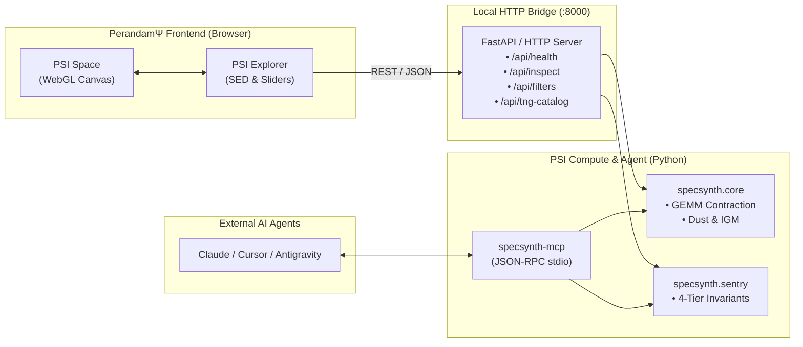

# Perandam Space Intelligence (PSI / PerandamΨ)
## Master Architectural Blueprint & System Specification

> **Organization**: Perandam Space Intelligence (PSI)  
> **Brand & Signature Mark**: PerandamΨ  
> **Tagline**: *AI-Native Computational Astrophysics*  
> **Core Mission**: Lowering the barrier to entry for the next generation of astrophysicists by unifying deterministic stellar population synthesis, real-time visual deep-field exploration, and autonomous agentic intelligence.

---

```
Perandam
└── Perandam Space Intelligence (PSI / PerandamΨ)
    ├── PSI Space      (Stellarium-inspired 60fps WebGL/Canvas interactive deep-field sky view)
    ├── PSI Explorer   (Detailed galaxy inspection card, rest-frame SED, filter footprints, live sliders)
    ├── PSI Atlas      (Mock survey catalogs: TNG, Roman, JWST, Euclid, synthetic deep fields)
    ├── PSI Compute    (SpecSynth in-flight contraction engine: Dask, BLAS, GPU, Zarr streaming)
    ├── PSI Agent      (SentryAgent & Model Context Protocol server for autonomous research reasoning)
    ├── PSI Notebook   (Interactive analytics, reproducible Jupyter notebooks & Python exports)
    └── PSI Publish    (Publication figures, JOSS/ApJ data bundles & reproducibility manifests)
```

---

## 1. Etymology, Physics, and Dual Heritage

### 1.1 The Classical Tamil Cosmological Root: *Perandam* (பேரண்டம்)
- **பேர் / பெரு (*Per / Peru*)**: Great, vast, cosmic, macro, infinite.
- **அண்டம் (*Andam*)**: The celestial egg, galaxy cluster, macrocosm, universe.
- In ancient Tamil cosmology and modern astronomy, **பேரண்டம் (*Perandam*)** denotes the entirety of the physical macrocosm—the infinite expanse containing billions of galaxies.

### 1.2 The Mathematical Physics Foundation: $\Psi$ and $\psi(t)$
In theoretical astrophysics and cosmology, the Greek letter **$\Psi$ / $\psi$** is foundational:
1. **Star Formation History $\psi(t)$**: Across all stellar population synthesis (SPS) literature, the star formation rate over cosmic time is universally denoted by $\psi(t) \equiv \mathrm{SFR}(t)$.
2. **Cosmological Wavefunction $\Psi_{\text{universe}}$**: In quantum cosmology, $\Psi$ represents the state vector describing the geometry and birth of the cosmos.
3. **Visual Geometry**: The symmetrical trident shape of $\Psi$ physically echoes an astronomical telescope dish, a light cone expanding through spacetime, or a diverging spectral beam.

---

## 2. Seven Pillars of the PSI Ecosystem

### 2.1 PSI Space (The Interactive Sky)
A zero-install, GPU-accelerated 2D/WebGL canvas allowing researchers, educators, and students to pan and zoom through simulated cosmic deep fields at a fluid 60 frames per second.
- **Photometric True-Color Composites**: Renders synthetic galaxy points according to real telescope filter bandpasses (e.g. JWST NIRCam RGB: Red = F444W, Green = F200W, Blue = F090W).
- **Celestial Coordinates**: Displays dynamic Right Ascension (RA) and Declination (Dec) coordinate grids with adaptive zoom resolution.
- **Flux Scaling**: Dynamic logarithmic dynamic range compression ($L = \log(1 + I/I_0)$) prevents saturated bright targets from washing out faint, high-$z$ candidates.

### 2.2 PSI Explorer (The Deep Inspector)
When an astronomer clicks any galaxy in PSI Space, the PSI Explorer card slides into view:
- **Physical Metadata**: Stellar mass $M_*$, redshift $z$, instantaneous star formation rate $\psi$, and Charlot & Fall (2000) two-component dust optical depths ($\tau_{\text{diffuse}}, \tau_{\text{birth}}$).
- **Rest-Frame SED Overlay**: Renders composite stellar spectra across rest-frame wavelengths ($\lambda \in [912\,\text{Å}, 50{,}000\,\text{Å}]$) with translucent overlays of active instrument transmission curves.
- **Photometric Distribution**: Bar and point plots of synthetic fluxes across all chosen filter bands.
- **Real-Time Sliders**: Interactive parameter adjustments ($z$ and dust $A_V$) that re-evaluate the observed-frame SED and color coordinates on the fly.
- **Scientific Sentry Badge**: Live certification indicating that the galaxy's physical parameters and colors conform to physical boundary invariants.

### 2.3 PSI Atlas (The Catalog Repository)
A curated library of observational and cosmological simulation datasets:
- **IllustrisTNG**: Hydrodynamic cosmological simulation catalogs mapped directly into synthetic photometry.
- **Roman High-Latitude Survey Mock**: Wide-field cosmological mock catalogs.
- **JWST Deep Fields**: Synthetic deep fields modeled for NIRCam and MIRI surveys.
- **CosmoDC2 / Euclid**: Large-scale structure mock lightcones.

### 2.4 PSI Compute (The SpecSynth Core Engine)
The deterministic, mathematically exact back-end engine:
- In-flight GEMM matrix contraction ($S = \text{SFH} \cdot \text{SSP}$, $F = S \cdot T_{\text{filter}}$).
- Eliminates intermediate full-spectrum disk writes, reducing storage footprint by $250\times$.
- Charlot & Fall (2000) birth cloud and diffuse interstellar dust models.
- Madau (1995) intergalactic medium (IGM) attenuation with redshift-dependent resonant Ly$\alpha$ and photoelectric absorption.
- Flat $\Lambda$CDM cosmological distance dimming.

### 2.5 PSI Agent (Autonomous AI Intelligence)
Driven by the Model Context Protocol (MCP) and SentryAgent:
- **`specsynth-mcp`**: Exposes SPS capabilities, filter projection matrices, SED inspection, and dataset queries via standard JSON-RPC.
- **SentryAgent**: Autonomous 4-tier diagnostic verification agent that detects anomalies (numerical non-finites, unphysical spectral indices like $D_n4000 < 0.5$, population collapses), isolates root causes, and purges corruptions.

### 2.6 PSI Notebook (Interactive Workflows)
- Seamless bridge between the visual GUI and Python code.
- One-click export: click a galaxy in PSI Explorer and copy the exact Python/Dask code snippet required to reproduce its SED and photometry in a local Jupyter environment.

### 2.7 PSI Publish (Publication Artifacts)
- Direct export of publication-ready vector figures (PDF/SVG) matching ApJ/MNRAS style guides.
- Automatic generation of reproduction manifests with SHA-256 filter checksums, adapter version metadata, and system hardware profiling.

---

## 3. Communication & Connectivity Protocol



1. **Offline Mode (Zero-Install)**: `perandam-psi` packages curated JSON/binary datasets (starting with the validated TNG → JWST NIRCam sample) directly inside the web client.
2. **Live Engine Mode**: When `python -m specsynth.mcp.bridge --port 8000` is active, the web client seamlessly unlocks live on-the-fly synthesis, custom Zarr imports, and real-time Sentry audits.
3. **Agent Mode**: AI coding agents connect directly to `specsynth.mcp.server` via stdio, orchestrating simulations via conversational queries.

---

## 4. Capability Maturity Matrix

Every architectural claim and functional module across the SpecSynth and PerandamΨ platform is mapped below to its empirical maturity status, code implementation, and automated test suite:

- **`Validated`**: Fully implemented, verified against analytical or external empirical standards, and strictly gated by automated CI regression tests.
- **`Implemented`**: Fully operational with unit test coverage and production implementation.
- **`Prototype`**: Functional proof-of-concept with demonstration dataset support.
- **`Planned`**: Formally specified roadmap feature slated for future milestone releases.

| Capability / Module | Maturity Status | Operational Scope | Code Location | Verification Suite / Manifests |
| :--- | :---: | :--- | :--- | :--- |
| **In-Flight GEMM Matrix Contraction** | `Validated` | Direct contraction of delayed-$\tau$ SFH and SSP into broadband photometry in-flight ($1{,}510.5\,\mathrm{gal/s}$ GEMM, $896.6\,\mathrm{gal/s}$ full pipeline). | `specsynth/core.py` | `tests/test_core.py`, `paper/benchmark_manifest_tng_jwst.json` |
| **Cosmological Redshift & FLRW Distance** | `Validated` | Flat $\Lambda\text{CDM}$ (Planck 2015) distance dimming $D_L(z)$ and $(1+z)^{-1}$ flux scaling without division singularities. | `specsynth/cosmology.py` | `tests/test_cosmology.py`, `tests/test_tng_jwst_validation.py` |
| **Cryptographic Filter Verification** | `Validated` | SHA-256 integrity digests for bundled STScI calibrated transmission curves (JWST, HST, SDSS). | `specsynth/filters.py` | `tests/test_filters.py`, `tests/test_tng_jwst_validation.py` |
| **Charlot & Fall Dust & Madau IGM** | `Validated` | Two-component dust attenuation with physical absorption non-amplification invariant and resonant Ly$\alpha$ / photoelectric Lyman forest absorption. | `specsynth/core.py`, `specsynth/igm.py` | `tests/test_igm.py`, `tests/test_tng_jwst_validation.py` |
| **Scientific Sentry QA Diagnostics** | `Validated` | 4-tier physics and numerical validation engine (finite fluxes, $D_n4000 \ge 0.7$, population color dispersion, quarantine). | `specsynth/sentry.py` | `tests/test_sentry.py` |
| **MCP Server & Strict JSON-RPC 2.0** | `Validated` | Model Context Protocol server exposing SPS tools with mutually exclusive `result` XOR `error` schemas and M8ven trust annotations. | `specsynth/mcp/server.py`, `perandam-psi/mcp_server.mjs` | `tests/test_mcp_server.py`, `tests/test_mcp_server_extended.py`, `perandam-psi/test/mcp_server.test.ts` |
| **Local Secure HTTP Bridge** | `Validated` | Zero-dependency HTTP bridge serving web SPA and REST endpoints with opt-in `--allow-remote` and Bearer token auth. | `specsynth/mcp/bridge.py` | `tests/test_bridge_security.py` |
| **PSI Space 2D SkyCanvas** | `Implemented` | Fluid 60fps pan/zoom sky view with adaptive celestial grids, dynamic range compression, and true-color filter composition. | `perandam-psi/src/components/SkyCanvas.tsx` | `perandam-psi/test/e2e_loaf.mjs` |
| **Interactive SED & Slider Forward-Modeling** | `Validated` | Real-time browser-side parameter synthesis ($z, A_V, M_*$) matching Python SpecSynth within $\|\Delta m\| < 0.005\,\mathrm{mag}$. | `perandam-psi/src/components/GalaxyInspector.tsx` | `perandam-psi/test/physics.test.ts`, `verify_tng_galaxy.py` |
| **E2E & W3C LoAF Performance Monitoring** | `Validated` | Headless Chrome CDP suite monitoring Core Web Vitals (FCP, LCP, CLS) and W3C Long Animation Frames API during slider sweeps. | `perandam-psi/test/e2e_loaf.mjs` | GitHub Actions CI (`.github/workflows/ci.yml`) |
| **Multi-Node Kubernetes Dask Execution** | `Validated` | Distributed synthesis over 100,000+ galaxies sustaining $53{,}814\,\mathrm{gal/s}$ across Dask Operator nodes with shared NFS. | `k8s/dask-cluster.yaml` | `paper/benchmark_manifest_oci_oke_3node.json` |
| **Autonomous Remediation Agent** | `Implemented` | SentryAgent isolating catalog corruptions, executing quarantined purges, and producing verified clean catalogs. | `specsynth/agent.py` | `tests/test_agent.py` |
| **Multi-Survey Catalogs (Roman / Euclid / CosmoDC2)** | `Prototype` | Pre-configured schema adapters and mock lightcone projections for wide-field surveys. | `specsynth/adapters/` | Synthetic demonstration mocks |
| **IFU Kinematic Spectral Slicing** | `Planned` | Spatial-spectral datacube generation modeling rotational velocity fields and velocity dispersion for JWST NIRSpec IFU. | Roadmap | Architectural Blueprint Phase 5 |

