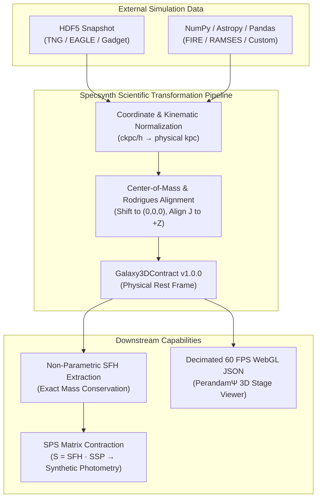

# Guide: Ingesting External Cosmological Simulations into Specsynth

This guide explains how an independent astrophysicist or research group can plug any external cosmological simulation (e.g. **IllustrisTNG, EAGLE, FIRE, Simba, Gizmo, RAMSES, or custom snapshots**) into the Specsynth ecosystem **without modifying any core framework code**.

---

## 1. Architectural Philosophy: Zero-Core-Modification Pluggability

Specsynth strictly decouples astrophysical data extraction from spectral synthesis and visualization using versioned contracts:



---

## 2. Ingestion Path A: Standard HDF5 Snapshots (TNG / EAGLE / Gadget / Arepo)

If your simulation is saved in standard Gadget/Arepo/HDF5 format with particle blocks (`PartType0` for gas, `PartType1` for dark matter, `PartType4` for stars):

```python
from specsynth.simulation import load_simulation_snapshot

# 1. Load snapshot file
galaxy = load_simulation_snapshot(
    source="path/to/subhalo_cutout.hdf5",
    sim_type="tng",                 # 'tng', 'eagle', or 'gadget'
    galaxy_id="my_tng_galaxy_01",
    subhalo_id=9873,
    redshift=0.998,                 # Overrides header if necessary
    h=0.6774,                       # Hubble parameter h = H0 / 100
    align_angular_momentum=True,    # Rotates disk into X-Y plane
)

print(f"Loaded: {galaxy.galaxy_id}")
print(f"Stellar Mass   : {galaxy.total_stellar_mass_msun():.2e} M_sun")
print(f"Half-Mass Radius: {galaxy.half_mass_radius_kpc:.2f} kpc")
print(f"Particle Counts : {galaxy.to_summary_dict()['particle_counts']}")
```

### Automatic Normalizations Performed by Specsynth:
1. **Coordinates**: Converted from comoving $\text{ckpc}/h$ to physical rest-frame $\text{kpc}$:
   $$r_{\text{phys}} = \frac{r_{\text{comov}}}{(1+z) h}$$
2. **Peculiar Velocities**: Converted from code units ($v \sqrt{a}$) to physical $\text{km/s}$.
3. **Masses**: Converted from $10^{10} M_\odot / h$ to physical solar masses $M_\odot$.
4. **Stellar Ages**: Formation scale factors $a_* = 1 / (1 + z_*)$ are integrated against the cosmological expansion rate to compute exact physical ages $t_{\text{age}} = t(z_{\text{snap}}) - t(z_*)$ in years.
5. **Kinematic Alignment**: Mass-weighted Center of Mass (CoM) translated to $(0, 0, 0)$, and total angular momentum $\vec{J}$ rotated to $+Z$ via Rodrigues rotation.

---

## 3. Ingestion Path B: Custom Particle Arrays (FIRE, RAMSES, Astropy, Pandas)

If your data comes from non-HDF5 files (CSV, Parquet, FITS tables, Astropy Tables) or an in-memory script, construct `ParticleBatchContract` objects directly:

```python
import numpy as np
from specsynth.contracts.galaxy3d import (
    Galaxy3DContract,
    ParticleBatchContract,
    ParticleType,
    GeometrySource,
)

# Example: 10,000 star particles from a custom simulation
n_stars = 10000
star_coords_kpc = np.random.normal(0, 3.5, size=(n_stars, 3)).astype(np.float32) # (N, 3) in physical kpc
star_vels_km_s  = np.random.normal(0, 150, size=(n_stars, 3)).astype(np.float32) # (N, 3) in km/s
star_masses_msun = np.full(n_stars, 1.2e5, dtype=np.float32)                    # (N,) in M_sun
star_ages_yr    = np.random.uniform(1e8, 8e9, size=n_stars).astype(np.float32)   # (N,) in years
star_mets_z     = np.random.uniform(0.004, 0.03, size=n_stars).astype(np.float32) # (N,) mass fraction Z

# 1. Wrap into ParticleBatchContract
star_batch = ParticleBatchContract(
    particle_type=ParticleType.STAR,
    coordinates_kpc=star_coords_kpc,
    velocities_km_s=star_vels_km_s,
    masses_msun=star_masses_msun,
    ages_yr=star_ages_yr,
    metallicities_z=star_mets_z,
)

# 2. Build Galaxy3DContract (automatically centers CoM and aligns disk to +Z)
galaxy = Galaxy3DContract.from_particles(
    galaxy_id="fire_galaxy_custom_01",
    redshift=0.5,
    components={"star": star_batch},
    geometry_source=GeometrySource.SIMULATION_DERIVED,
    align_angular_momentum=True,
    provenance={
        "simulation": "FIRE-3",
        "snapshot": 400,
        "author": "Research Group",
    },
)

print(f"Stellar Half-Mass Radius: {galaxy.half_mass_radius_kpc:.2f} kpc")
```

---

## 4. Ingestion Path C: Spectral Synthesis & Synthetic Photometry

Once the galaxy is ingested, you can link its 3D particles directly to Specsynth's spectral synthesis engine without intermediate spectra:

```python
from specsynth.adapters.fsps import FSPSAdapter
from specsynth.core import project_photometry
from specsynth.filters import load_filter_curves

# 1. Define standard age and metallicity grids matching your SPS library
ages_yr = np.logspace(7.0, 10.1, 40)              # 40 stellar age bins (10 Myr to 12.5 Gyr)
mets_z  = np.array([0.004, 0.008, 0.019, 0.03])   # 4 metallicity bins

# 2. Extract non-parametric SFH matrix (exact mass conservation)
# formed_mass=True applies Leitner & Kravtsov (2011) stellar death recycling
sfh_matrix = galaxy.extract_non_parametric_sfh(ages_yr, mets_z, formed_mass=True)
print(f"SFH Matrix Shape: {sfh_matrix.shape}") # (1, 160)

# 3. Load FSPS or BC03 SPS matrix
fsps = FSPSAdapter("sample_models/fsps/fsps_full_chabrier_mist.spec")
ssp_contract = fsps.to_contract()
ssp_grid = ssp_contract.flux_grid # (160, N_wave)

# 4. Matrix contraction: S = SFH @ SSP
rest_sed = sfh_matrix @ ssp_grid  # Shape: (1, N_wave) in L_sun / A

print(f"Synthesized Rest-Frame SED with {ssp_contract.n_wave} wavelength bins!")
```

---

## 5. Ingestion Path D: Exporting for PerandamΨ 3D WebGL Visualization

To explore your simulation in 3D in the PerandamΨ browser stage:

```python
from specsynth.simulation import export_galaxy3d_web_json

# Export decimated JSON (downsamples to 5,000 particles preserving density and mass)
export_galaxy3d_web_json(
    galaxy=galaxy,
    filepath="perandam-psi/public/my_galaxy_3d.json",
    max_particles_per_component=5000,
    seed=42,
)
```

In PerandamΨ:
1. The 3D stage automatically displays the **`SIMULATION-DERIVED`** empirical badge.
2. Individual particles are colored based on stellar population age (blue for young OB stars, ivory for main sequence, amber for old evolved giants).
3. Galaxy disks are rendered in the horizontal stage plane ($X\text{-}Z$ in Three.js).
