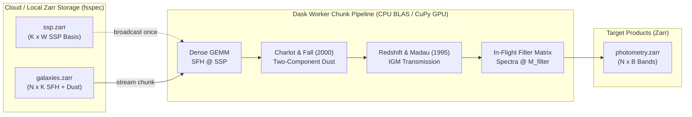

# specsynth

**Cloud-native distributed infrastructure for survey-scale astrophysical stellar population synthesis (SPS) and in-flight photometric forward-modeling.**

`specsynth` decouples offline Simple Stellar Population (SSP) basis compilation from online streaming synthesis. By combining chunked **Zarr** arrays over `fsspec`, **Dask** distributed task graphs, and optional **CuPy** GPU BLAS contractions, `specsynth` streams galaxy star formation histories (SFHs) from local disks or cloud object storage (`s3://`, `gs://`, `abfs://`), applies Charlot & Fall (2000) two-component dust attenuation and Madau (1995) IGM transmission, and projects spectra directly into broadband photometry in-flight without materializing multi-terabyte intermediate spectra to disk.

---

## Key Capabilities

- **Memory-Bounded Out-of-Core Streaming**: Worker memory stays strictly bounded to one galaxy chunk ($O(N_{\text{chunk}})$), verified with < 0.2% RAM variance from 100k to 1M galaxies.
- **In-Flight Filter Projection**: Projects chunk spectra directly into calibrated JWST NIRCam, HST ACS/WFC3, SDSS, Rubin/LSST, or custom throughput curves, reducing persistent output storage by > 99.9%.
- **Pluggable SPS Library Adapters**: Native loaders for Bruzual & Charlot (2003) `.ised`/ASCII, E-MILES/MILES FITS, FSPS (`python-fsps` and `spstot_*.spec`), BPASS v2.2+, and arbitrary 3D FITS/HDF5/NPZ SSP grids.
- **Simulation Catalog Ingestion**: Imports mock galaxy catalogs from Parquet, FITS, HDF5, CSV, and NPZ (including IllustrisTNG, EAGLE, CAMELS, and semi-analytic models).
- **Snapshot & Lightcone Cosmology**: Built-in `FlatLambdaCDM` luminosity-distance flux scaling, $(1+z)$ rest-to-observed bandpass shifting, and Madau (1995) neutral-hydrogen IGM attenuation.
- **CPU BLAS & GPU Acceleration**: Vectorized `scipy-openblas` / NumPy GEMM on CPUs with transparent CuPy CUDA acceleration on NVIDIA GPUs.
- **Automated Scientific Sentry**: Four-tier inline and post-hoc numerical/astrophysical validation catching non-finite fluxes, energy conservation violations, and unphysical $D_n(4000)$ or UV-slope outliers.

---

## Architecture Overview

---

## Quick Navigation

- New to `specsynth`? Start with [Installation](getting-started/installation.md) and the [5-Minute Quickstart](getting-started/quickstart.md).
- Integrating real stellar libraries? See [SSP Model Adapters](guides/adapters.md).
- Forward-modeling IllustrisTNG or lightcone catalogs? See [Catalogs, Cosmology & Filters](guides/catalogs-and-photometry.md).
- Scaling across Kubernetes or GPUs? See [Distributed, Cloud & GPU Execution](guides/distributed-and-gpu.md).
- Looking for numerical tolerances and cross-code checks? See [Validation & Benchmarks](guides/validation-and-benchmarks.md).
- Programmatic usage? Browse the [Python API Reference](api/index.md) or [CLI Reference](cli.md).
