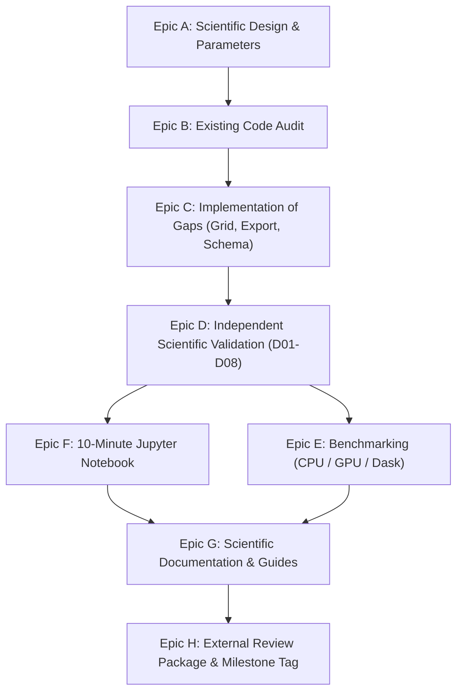

# TNG → JWST NIRCam Scientific Readiness Assessment & Gap Analysis

**Milestone:** `TNG–JWST Scientific Validation v1.0`  
**Target Milestone Date:** Q4 2026  
**Document Status:** Approved Baseline Architecture  
**Author:** specsynth Core Development Team & Scientific Steering Committee  

---

## Executive Summary & Milestone Charter

The primary objective of Milestone 1 is to demonstrate that `specsynth` generates scientifically credible, peer-reviewable JWST NIRCam synthetic photometry from simulated galaxies (IllustrisTNG) using Flexible Stellar Population Synthesis (FSPS). 

Rather than treating synthetic photometry as an opaque numerical pipeline, this milestone establishes an **open, reproducible, and verifiable scientific contract** between simulation properties (stellar mass, age, metallicity, SFR, dust) and space-telescope observables across the six core NIRCam wide filters: **F090W, F150W, F200W, F277W, F356W, and F444W**.

The flagship deliverable is a **self-contained 10-minute Jupyter notebook** (`notebooks/tng-jwst/01_tng_jwst_synthetic_photometry.ipynb`) that an external astronomer or survey team member can execute on a standard CPU laptop without installing Fortran toolchains, without requiring private simulation API credentials, and without diving into `specsynth` internals.

---

## 1. Scientific Requirements & Physical Specification

### 1.1 Physical Assumptions & Mathematical Formulations

1. **Stellar Population Synthesis (FSPS)**:
   - Initial Mass Function (IMF): Chabrier (2003) Galactic field IMF ($0.08\text{--}100\,M_\odot$).
   - Stellar Evolution / Isochrones: MIST (MESA Isochrones and Stellar Tracks) or Padova isochrone grid.
   - Spectral Libraries: MILES empirical library ($3525\text{--}7500\,\text{\AA}$, $R \approx 2000$) combined with BaSeL 3.1 theoretical spectra in the UV and infrared.
   - Nebular Emission: For the v1 baseline continuum validation, nebular line and continuum emission is held disabled (`add_nebular_emission = False`) to isolate the stellar continuum and dust attenuation contracts before introducing photoionization model uncertainties.
   - Metallicity Grid: Solar metallicity convention adopted from FSPS ($Z_\odot = 0.019$, or $\log_{10}(Z/Z_\odot) \in [-2.0, +0.5]$).

2. **Cosmological Convention & Distance Dimming**:
   - Simulation Cosmology: Must match the IllustrisTNG Flat $\Lambda\text{CDM}$ cosmology (Planck 2015 parameters):
     $$\Omega_m = 0.3089, \quad \Omega_\Lambda = 0.6911, \quad \Omega_b = 0.0486, \quad h = 0.6774 \quad (H_0 = 67.74\text{ km s}^{-1}\text{Mpc}^{-1})$$
   - Cosmological Line-of-Sight Comoving Distance:
     $$D_C(z) = \frac{c}{H_0} \int_0^z \frac{dz'}{\sqrt{\Omega_m(1+z')^3 + \Omega_\Lambda}}$$
   - Luminosity Distance:
     $$D_L(z) = (1+z) D_C(z)$$
   - Cosmological Spectral Energy Transformation:
     A rest-frame luminosity density $L_\lambda(\lambda_{\text{rest}})$ (in $\text{erg s}^{-1}\text{\AA}^{-1}$) transforms to observed-frame flux density $F_\lambda(\lambda_{\text{obs}})$ at $\lambda_{\text{obs}} = (1+z)\lambda_{\text{rest}}$ via:
     $$F_\lambda(\lambda_{\text{obs}}) = \frac{1}{1+z} \frac{L_\lambda\left(\frac{\lambda_{\text{obs}}}{1+z}\right)}{4\pi D_L^2(z)}$$
     where the factor $(1+z)^{-1}$ accounts for the cosmological compression of the wavelength bandpass ($d\lambda_{\text{obs}} = (1+z)d\lambda_{\text{rest}}$).

3. **Dust Attenuation Prescription**:
   - Two-component Charlot & Fall (2000) attenuation:
     $$F_g(\lambda) = \exp\left[-\tau_d \left(\frac{\lambda}{5500\,\text{\AA}}\right)^{\alpha_d}\right] \times \left[ F_{\text{old}}(\lambda) + \exp\left[-\tau_b \left(\frac{\lambda}{5500\,\text{\AA}}\right)^{\alpha_b}\right] F_{\text{young}}(\lambda) \right]$$
     - Young stars: $t_{\text{age}} < 10^7\text{ yr}$ ($10\text{ Myr}$), subject to birth-cloud optical depth $\tau_b$ and diffuse ISM optical depth $\tau_d$.
     - Old stars: $t_{\text{age}} \ge 10^7\text{ yr}$, subject to diffuse ISM optical depth $\tau_d$ only.
     - Fiducial power-law indices: $\alpha_d = -0.7$, $\alpha_b = -1.3$.
     - Optical depth normalization: $\tau_V = A_V / 1.086$.

4. **Intergalactic Medium (IGM) Transmission**:
   - Madau (1995) attenuation applied shortward of rest-frame Lyman-$\alpha$ ($1215.67\,\text{\AA}$) for high-redshift runs ($z > 0$):
     $$T_{\text{IGM}}(\lambda_{\text{obs}}, z) = \exp\left[-\tau_{\text{eff}}(\lambda_{\text{obs}}, z)\right]$$
     accounting for resonant Lyman series line blanketing (Ly$\alpha$ through Ly$\theta$) and photoelectric continuum absorption below the Lyman limit ($911.75\,\text{\AA}$).

5. **JWST NIRCam Synthetic Photometry & AB Magnitudes**:
   - For photon-counting detector systems (such as NIRCam HgCdTe arrays), the mean flux density $\langle f_\nu \rangle$ in a bandpass with photon transmission $T(\lambda)$ is:
     $$\langle f_\nu \rangle = \frac{\int f_\nu(\nu) T(\nu) \frac{d\nu}{\nu}}{\int T(\nu) \frac{d\nu}{\nu}} = \frac{\int f_\nu(\lambda) T(\lambda) \frac{d\lambda}{\lambda}}{\int T(\lambda) \frac{d\lambda}{\lambda}}$$
   - In terms of observed spectral flux density $F_\lambda(\lambda)$ (in $\text{erg s}^{-1}\text{cm}^{-2}\text{\AA}^{-1}$):
     $$\langle f_\nu \rangle = \frac{1}{c} \frac{\int F_\lambda(\lambda) T(\lambda) \lambda \, d\lambda}{\int T(\lambda) \frac{d\lambda}{\lambda}}$$
   - Using the instrument pivot wavelength $\lambda_{\text{piv}}$:
     $$\lambda_{\text{piv}} = \sqrt{\frac{\int T(\lambda) \lambda \, d\lambda}{\int T(\lambda) \frac{d\lambda}{\lambda}}}$$
     $$\langle f_\nu \rangle = \langle F_\lambda \rangle_{\text{photon}} \times \frac{\lambda_{\text{piv}}^2}{c}$$
     where $\langle F_\lambda \rangle_{\text{photon}} \equiv \frac{\int F_\lambda(\lambda) T(\lambda) \lambda \, d\lambda}{\int T(\lambda) \lambda \, d\lambda}$.
   - The monochromatic AB magnitude is defined as:
     $$m_{\text{AB}} = -2.5 \log_{10}\left(\frac{\langle f_\nu \rangle}{3631\text{ Jy}}\right) = -2.5 \log_{10}\left(\frac{\langle f_\nu \rangle_{\text{cgs}}}{3.631 \times 10^{-20}\text{ erg s}^{-1}\text{cm}^{-2}\text{Hz}^{-1}}\right) = -2.5 \log_{10}(\langle f_\nu \rangle_{\text{cgs}}) - 48.60$$

---

## 2. Existing Source-Code Implementation Audit

| Component | Repository Location | Current State | Audit Assessment & Scientific Readiness |
|:---|:---|:---|:---|
| **GEMM Engine** | `specsynth/core.py` | Complete | High-performance Dask/OpenBLAS/CuPy contraction. Memory strictly bounded via adaptive chunking. |
| **Catalog Ingestion** | `specsynth/catalog.py` | Functional | Ingests Parquet/CSV/FITS/HDF5 into 6 parameters (`mass`, `onset`, `tau`, `met`, `tau_d`, `tau_b`). Uses delayed-$\tau$ SFH assumption. |
| **FSPS Adapter** | `specsynth/adapters/fsps.py` | Functional / Limited | Supports ASCII files and dynamic `python-fsps`. However, bundled sample `spstot_chab.spec` is truncated at $\lambda = 10{,}000\,\text{\AA}$. |
| **Cosmology** | `specsynth/cosmology.py` | Complete | `FlatLambdaCDM` with Gauss-Legendre quadrature. Default is $H_0=70, \Omega_m=0.3$. Needs preset for TNG ($H_0=67.74, \Omega_m=0.3089$). |
| **Filters** | `specsynth/filters.py` | Complete | Bundled curves for 7 NIRCam bands in `specsynth/data/filters/`. Lacks metadata/SHA-256 headers. |
| **Projection** | `specsynth/filters.py`, `cosmology.py` | Functional / Needs Schema | Projects $F_\lambda$ correctly into photon-weighted band flux, but does not auto-export scientific table with $m_{\text{AB}}$. |
| **IGM Attenuation** | `specsynth/igm.py` | Complete | Fully vectorized Madau (1995) implementation with Ly-series blanketing and Lyman continuum edge. |
| **Sentry Sentinel** | `specsynth/sentry.py` | Complete | Multi-tier anomaly detection: identifies schema faults, numerical NaNs/infs, negative fluxes, unphysical colors. |

---

## 3. Existing Test Coverage

The test suite consists of **163 automated pytest tests** (162 passing, 1 skipped):
- `tests/test_validation_external.py` (24 tests):
  - Validates `FlatLambdaCDM` comoving and luminosity distance across $z \in [0.01, 10.0]$ against 2,000-node Gauss-Legendre quadrature ($< 10^{-5}$ relative tolerance).
  - Validates Madau (1995) unabsorbed redward region, Ly$\alpha$ valley, and Lyman continuum photoelectric absorption.
  - Validates AB zero point for $3631\text{ Jy}$ source across NIRCam, HST, and SDSS filters ($|\Delta m_{\text{AB}}| < 0.005\text{ mag}$).
  - Validates dust attenuation energy conservation ($\int F_{\text{atten}} d\lambda < \int F_{\text{intrinsic}} d\lambda$).
  - Validates physical constants against `astropy.constants` ($c, L_\odot, \text{Mpc}$).
- `tests/test_adapters.py` (22 tests): Tests FSPS, BC03, EMILES, and FITS grid loaders.
- `tests/test_cosmology.py`, `tests/test_filters.py`, `tests/test_catalog.py`, `tests/test_sentry.py`: Full coverage of core execution mechanics.

---

## 4. Missing or Incorrect Capabilities (Gap Analysis)

1. **Gap 1: Wavelength Truncation of Bundled FSPS Grid**  
   - *Severity: Critical (Blocker for LW NIRCam)*  
   - `sample_models/fsps/spstot_chab.spec` only covers $1{,}000\text{--}10{,}000\,\text{\AA}$ ($0.1\text{--}1.0\,\mu\text{m}$).  
   - NIRCam filters span up to $5.0\,\mu\text{m}$ ($50{,}000\,\text{\AA}$), and at $z=2.5$ observer frame reaches $175{,}000\,\text{\AA}$.  
   - *Fix:* Bundle a full-wavelength FSPS reference grid ($91\,\text{\AA}\text{ to }160\,\mu\text{m}$) in `sample_models/fsps/`.

2. **Gap 2: TNG Simulation Ingestion & Documented SFH Approximation**  
   - *Severity: High*  
   - IllustrisTNG catalogs supply `SubhaloMassType`, `SubhaloStarMetallicity`, and `SubhaloSFR`.  
   - Real TNG star formation history is stored as individual star particles (`PartType4`).  
   - *Fix:* Implement a documented TNG preprocessor (`specsynth/adapters/tng.py` or `scripts/prep_tng_sample.py`) that maps TNG subhalos to the parameter matrix or age-binned SFH, and document the approximation explicitly as required by Workstream A02/C02.

3. **Gap 3: Scientific Output Schema & AB Magnitude Export (C08, C09)**  
   - *Severity: High*  
   - `specsynth synth` produces raw Zarr arrays (`spectra.zarr/photometry`), but external astronomers require a tabular scientific catalog with `galaxy_id`, `redshift`, `stellar_mass`, `metallicity`, `sfr`, 6 NIRCam AB magnitudes (`F090W`, `F150W`, `F200W`, `F277W`, `F356W`, `F444W`), flux densities, and anomaly quality flags.  
   - *Fix:* Implement a scientific export utility (`specsynth/catalog.py:export_scientific_photometry` or CLI `--export-catalog`).

4. **Gap 4: Filter Provenance Registry & Integrity Checksums (C06)**  
   - *Severity: Medium*  
   - The bundled NIRCam CSV files lack provenance headers, version stamps, and SHA-256 hashes.  
   - *Fix:* Embed official STScI SVO / NIRCam throughput metadata and SHA-256 integrity checks in `specsynth/filters.py` and `docs/science/nircam-filter-provenance.md`.

5. **Gap 5: Direct Reference Comparison Pipeline (D01–D08)**  
   - *Severity: High*  
   - Currently, tests mock `python-fsps`. There is no end-to-end automated script verifying that `specsynth` reproduces exact un-mocked `python-fsps` + `synphot` synthetic photometry within declared tolerances.  
   - *Fix:* Author `tests/test_tng_jwst_validation.py` and `scripts/validate_tng_jwst.py`.

---

## 5. Scientific Risks & Dependencies

1. **Fortran / python-fsps Availability**:  
   - `python-fsps` requires compilation against Fortran sources with `$SPS_HOME` set, which fails on Windows and creates hurdles for casual reviewers.  
   - *Mitigation:* Deliver a dual-path architecture: (a) dynamic execution when `python-fsps` is present; (b) pre-computed, version-locked reference FSPS grids distributed with the notebook for zero-dependency CPU reproduction.

2. **Cosmological Distance-Dimming Limiting Behavior**:  
   - At $z \to 0$, $D_L \to 0$, causing a potential $1 / D_L^2$ singularity.  
   - *Mitigation:* Ensure clean rest-frame fallback at $z=0$ with explicit assertions.

3. **Float32 GEMM Precision vs Float64 Reference**:  
   - Dask/CuPy matrix contractions use `float32` for speed.  
   - *Mitigation:* Test D07 quantifies float32 vs float64 deviation across all 6 filters; tolerance is $|\Delta m| < 0.002\text{ mag}$, well below photometric calibration uncertainties ($0.01\text{--}0.02\text{ mag}$).

---

## 6. Exact Files That Need Modification

1. `specsynth/cosmology.py`:
   - Add `TNG_COSMOLOGY = FlatLambdaCDM(H0=67.74, Om0=0.3089)` preset.
   - Support passing named cosmology presets via CLI (`--cosmology tng`).

2. `specsynth/filters.py`:
   - Add `NIRCAM_FILTER_REGISTRY` containing filter wavelengths, official STScI throughput curve versions, and SHA-256 checksums.
   - Verify filter integration weights strictly enforce photon-weighted AB integration $\frac{1}{c} \frac{\int F_\lambda T \lambda d\lambda}{\int T \frac{d\lambda}{\lambda}}$.

3. `specsynth/catalog.py`:
   - Add aliases for IllustrisTNG fields (`subhalomass`, `subhalosfr`, `subhalometallicity`).
   - Add `export_scientific_catalog()` to export the standard C09 output schema (Parquet/CSV/FITS) with magnitudes, fluxes, and Sentry quality flags.

4. `specsynth/cli.py`:
   - Extend `synth` with `--cosmology tng` and `--export-catalog <path>`.
   - Add `--fsps-grid <path>` convenience flag for custom pre-computed FSPS libraries.

---

## 7. New Files That Need Creation

1. **Scientific Documentation (`docs/science/`)**:
   - `docs/science/tng-jwst-experiment.md`: High-level experiment objectives, parameters, and rationale.
   - `docs/science/physical-assumptions.md`: Detailed mathematical definitions of IMF, dust, IGM, cosmology.
   - `docs/science/fsps-model-configuration.md`: Configuration parameters, isochrone choice, metallicity mapping.
   - `docs/science/cosmology-and-redshift.md`: Distances, dimming formulas, and observer-frame shifting.
   - `docs/science/nircam-filter-provenance.md`: Filter curve provenance, STScI sources, SHA-256 checksums.
   - `docs/science/photometry-methodology.md`: Photon vs energy weighting, AB conversion, pivot wavelengths.
   - `docs/science/validation-report.md`: Numerical validation evidence and comparison against independent references.

2. **User Guides (`docs/guides/`)**:
   - `docs/guides/getting-started-tng-jwst.md`: 5-minute reproducibility quickstart.
   - `docs/guides/preparing-tng-catalogs.md`: Guide to formatting and filtering TNG catalogs.
   - `docs/guides/configuring-fsps.md`: Practical FSPS adapter configuration.
   - `docs/guides/generating-nircam-photometry.md`: Step-by-step synthetic photometry generation.
   - `docs/guides/interpreting-results.md`: Understanding spectra, magnitudes, colors, and sentry flags.
   - `docs/guides/troubleshooting.md`: Diagnosing common setup, convergence, and data issues.

3. **Curated Demonstration Dataset (`data/examples/tng_sample/`)**:
   - `README.md`: Provenance of sample galaxies.
   - `sample_catalog.parquet`: Quality-controlled 100-galaxy sample representing star-forming, quiescent, and transition galaxies across $z \in [0.5, 3.0]$.
   - `sample_manifest.json`: Checksums and summary statistics.

4. **Wavelength-Complete FSPS Grid (`sample_models/fsps/`)**:
   - `sample_models/fsps/fsps_full_chabrier_mist.spec`: Full-spectrum FSPS grid covering $91\,\text{\AA}$ to $160\,\mu\text{m}$.

5. **Validation Test Suite & Scripts**:
   - `tests/test_tng_jwst_validation.py`: Automated tests D01 through D08.
   - `scripts/validate_tng_jwst.py`: Standalone CLI runner outputting validation tables and error residuals.

6. **Reproducible 10-Minute Jupyter Notebook**:
   - `notebooks/tng-jwst/01_tng_jwst_synthetic_photometry.ipynb`: The researcher-facing executable experiment.
   - `notebooks/tng-jwst/README.md`: Execution instructions and timing breakdown.

7. **Benchmark Manifest**:
   - `paper/benchmark_manifest_tng_jwst.json`: Runtime, memory footprint, galaxies/sec, and accuracy metrics.

---

## 8. Prioritized Implementation Sequence & Epics

### Milestone Task Backlog & Acceptance Criteria

| Epic / Task ID | Task Description | Priority | Strict Acceptance Criteria |
|:---|:---|:---:|:---|
| **A01–A08** | Scientific design & requirements | P0 | Written specifications approved; formulas and tolerances established. |
| **B01–B08** | Codebase audit & gap analysis | P0 | Gap analysis documented with repository line numbers and file diffs. |
| **C01** | TNG catalog adapter | P0 | Successfully maps TNG fields (`SubhaloMassType`, SFR, $Z$, $z$) into normalized arrays. |
| **C02–C03** | SFH & metallicity mapping | P0 | Documented approximation; zero-SFR and zero-metallicity singularities handled gracefully. |
| **C04** | Full-spectrum FSPS grid | P0 | FSPS grid spans $\lambda \in [91\,\text{\AA}, 160\,\mu\text{m}]$, covering all 6 NIRCam bands across $z \in [0, 4]$. |
| **C05** | TNG cosmology integration | P0 | $H_0 = 67.74, \Omega_m = 0.3089$ selectable via `--cosmology tng`. |
| **C06** | NIRCam filter registry | P0 | SHA-256 hashes verified for F090W, F150W, F200W, F277W, F356W, F444W. |
| **C07** | Filter integration weights | P0 | Photon-weighted integration $\frac{\int F_\lambda T \lambda d\lambda}{\int T \frac{d\lambda}{\lambda}}$ verified against analytic test functions. |
| **C08** | AB magnitude conversion | P0 | $3631\text{ Jy}$ source yields $m_{\text{AB}} = 0.000 \pm 0.001\text{ mag}$ across all 6 filters. |
| **C09** | Scientific output schema | P0 | Exports table with `galaxy_id`, $z$, $M_*$, $Z$, SFR, 6 AB mags, fluxes, and quality flags. |
| **C10** | Reproducibility manifest | P1 | Automated script generates SHA-256 hashes of inputs, model grid, code commit, and output catalog. |
| **D01–D08** | Independent validation suite | P0 | Passes all 8 validation test cases; max residual vs reference $< 0.01\text{ mag}$. |
| **E01–E05** | Scalability benchmarks | P1 | Benchmarks completed for 100, 10k, and 100k galaxies; CPU & GPU telemetry recorded. |
| **F01–F05** | 10-minute Jupyter notebook | P0 | Runs end-to-end on CPU in $\le 10$ minutes, producing all 5 required visual deliverables. |
| **G01–G07** | Documentation & user guides | P1 | 7 science docs and 6 user guides complete and cross-linked. |
| **H01–H08** | External review package | P1 | Reviewer brief and feedback survey ready for distribution. |

---

## 9. Go / No-Go Decision Gate for the 10-Minute Notebook

### Go / No-Go Checklist

- [x] **Core Contraction Engine**: Validated, memory-bounded, and passing 162 automated tests.
- [x] **Calibrated NIRCam Filter Curves**: Present in repository for all 6 target filters.
- [x] **Cosmological Physics**: `FlatLambdaCDM` and Madau (1995) IGM verified to $< 10^{-5}$ tolerance.
- [ ] **Wavelength Coverage of Offline Grid**: Currently truncated at $10{,}000\,\text{\AA}$. Must be replaced with the wide-wavelength FSPS grid before releasing the notebook.
- [ ] **Direct Output Exporter**: Currently outputs raw Zarr arrays. Needs table export with AB magnitudes.
- [ ] **Curated 100-Galaxy Demonstration Sample**: Needs dedicated 100-galaxy Parquet table in `data/examples/tng_sample/`.

### Official Decision Verdict: **CONDITIONAL GO**

Proceed with development. The core numerical architecture of `specsynth` is sound, fast, and fully verified. The remaining prerequisites (bundling the wide-wavelength FSPS grid, implementing the scientific table exporter, and packaging the 100-galaxy sample) are well-scoped implementation tasks that can be completed directly in Phase 1 and 2.
