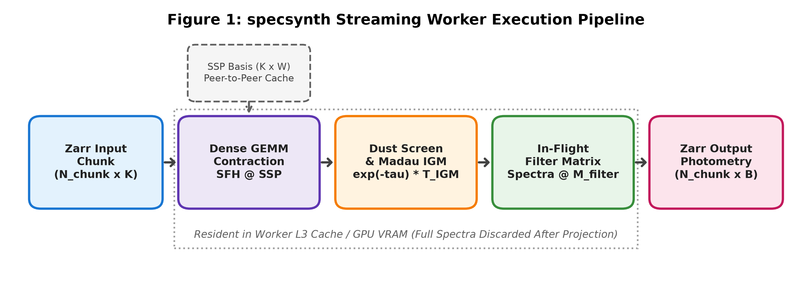

# Summary

Forward-modeling synthetic spectra and broadband photometry for millions to billions of simulated galaxies is a core requirement for interpreting wide-field cosmological surveys, including the Vera C. Rubin Observatory's Legacy Survey of Space and Time (LSST) [@ivezic2019lsst], the Euclid mission [@mellier2025euclid], and the Nancy Grace Roman Space Telescope [@akeson2019wfirst].

`specsynth` is an open-source Python framework for distributed, out-of-core stellar population synthesis (SPS) and in-flight photometric forward-modeling. Rather than introducing a new stellar evolution model, `specsynth` reformulates composite stellar population synthesis as a cloud-native matrix-streaming pipeline built on chunked Zarr storage over `fsspec`, Dask distributed task graphs [@rocklin2015dask], NumPy/OpenBLAS [@harris2020array], and optional CuPy GPU contractions [@okuta2017cupy]. Galaxy star formation histories (SFHs) stream from local storage or cloud object stores (`s3://`, `gs://`, `abfs://`), contract against pre-compiled Simple Stellar Population (SSP) grids in worker cache or VRAM, undergo dust and intergalactic medium (IGM) attenuation, and project directly into photometric bandpasses in-flight without writing multi-terabyte intermediate spectra to disk.

# Statement of need

Cosmological hydrodynamical simulations such as IllustrisTNG [@pillepich2018simulating] and large semi-analytic mock catalogs routinely contain $10^6$ to $10^9$ simulated galaxies. Translating their SFHs, metallicities, and dust properties into survey-ready broadband photometry exposes three recurring systems bottlenecks for astrophysicists:

1. **Intermediate Storage Explosion**: Evaluating high-resolution spectra ($W \approx 2{,}000\text{--}10{,}000$ wavelength bins) for $10^8$ galaxies produces multiple terabytes of intermediate spectral arrays that are frequently discarded immediately after integrating into 5--15 photometric bands.
2. **Memory & Serialization Overhead**: Wrapping stateful single-galaxy Fortran/C integrators inside parallel loops duplicates per-worker model state and forces POSIX shared filesystems (NFS/Lustre), whereas monolithic in-memory NumPy arrays exhaust host RAM or GPU VRAM as catalog sizes grow.
3. **Silent Catalog Corruption at Scale**: Manual inspection of individual SEDs is infeasible across millions of simulated subhalos, allowing unphysical edge cases (zero-metallicity singularities, negative fluxes, or out-of-range breaks) to propagate silently into downstream cosmological analyses.

`specsynth` targets survey simulation teams, mock-catalog builders, and extragalactic researchers who need exact, memory-bounded, cloud-native forward modeling from standard SSP libraries across laptops, GPUs, and Kubernetes/HPC clusters.

# State of the field

The astrophysical SPS ecosystem spans several mature software paradigms, each optimized for distinct scientific workflows:

- **Single-Galaxy Precision & SED Inference**: `FSPS` [@conroy2009propagation] and `BC03` [@bruzual2003stellar] provide foundational stellar evolution libraries and spectral integrators, while `Prospector` [@johnson2021prospector] and `BAGPIPES` [@carnall2018bagpipes] wrap them for Bayesian parameter inference on observed galaxies. These tools excel at detailed per-object modeling and MCMC/nested-sampling inference, not cloud-native out-of-core forward modeling of $10^7\text{--}10^9$ mock galaxies.
- **Differentiable & Neural Emulators**: `DSPS` [@hearin2023dsps] provides JAX-based differentiable SPS for gradient-driven inference and fast GPU evaluation, while `SPECULATOR` [@alsing2020speculator] trains neural surrogates for rapid spectral approximation. However, `DSPS` targets in-memory JAX arrays rather than distributed cloud object-store streaming, and neural emulators introduce surrogate approximation errors and require retraining whenever SSP grids, IMFs, or dust laws change.
- **Object-Oriented Synthetic Observable Frameworks**: `Synthesizer` [@lovell2025synthesizer; @roper2026synthesizer] provides a comprehensive, extensible Python framework for generating synthetic spectra, emission lines, images, and photometry from cosmological simulations using rich galaxy/grid abstractions and photoionization models.

**Build vs. Contribute Rationale**: Rather than re-implementing nebular photoionization or Bayesian SED fitting already well served by `Synthesizer`, `Prospector`, and `DSPS`, `specsynth` was built as a focused, lightweight execution engine dedicated to a narrower problem: **strictly memory-bounded, out-of-core Zarr/Dask/CuPy streaming with in-flight filter contraction** and zero shared-filesystem requirements. Because `specsynth` consumes standardized `(K, W)` SSP matrices via pluggable adapters (BC03, E-MILES [@vazdekis2016uv], FSPS, BPASS [@eldridge2017binary], or generic FITS/HDF5/NPZ grids), it complements upstream SSP generators and simulation frameworks by scaling linear continuum + dust + IGM photometric projection directly over cloud object storage.

# Software design

`specsynth` separates offline SSP grid compilation from online chunked synthesis so that worker memory remains strictly $O(N_{\text{chunk}} \times W)$ independent of total catalog size (Figure 1).

### Physical Model & In-Flight Contraction
For each galaxy $g$, composite flux density follows the Charlot & Fall (2000) two-component dust attenuation model [@charlot2000simple]:

$$F_g(\lambda) = D_g(\lambda)\left[\sum_{k \in \text{old}} \mathrm{SFH}[g,k]\,\mathrm{SSP}[k,\lambda] + B_g(\lambda)\sum_{k \in \text{young}} \mathrm{SFH}[g,k]\,\mathrm{SSP}[k,\lambda]\right]$$

where young populations ($< 10^7\text{ yr}$) experience additional birth-cloud attenuation $B_g(\lambda) = \exp(-\tau_b(\lambda / 5500\,\text{\AA})^{\alpha_b})$ on top of diffuse ISM attenuation $D_g(\lambda) = \exp(-\tau_d(\lambda / 5500\,\text{\AA})^{\alpha_d})$. Per galaxy chunk, this evaluates as two dense `float32` GEMM calls (`SFH @ SSP`) backed by OpenBLAS on CPU or CuPy/cuBLAS on NVIDIA GPUs. Cosmological snapshot and per-galaxy lightcone modes apply `FlatLambdaCDM` luminosity-distance dimming ($F_\lambda = L_{\lambda/(1+z)} / [4\pi D_L^2(1+z)]$) and Madau (1995) IGM transmission [@madau1995radiative]. When broadband photometry is requested, chunk spectra are contracted in-flight against a pre-built filter matrix ($\mathbf{Phot} = \mathbf{F}_{\text{chunk}}\mathbf{M}_{\text{filter}}$) using bundled calibrated JWST NIRCam, HST ACS/WFC3, and SDSS curves (or user-supplied tables) and immediately discarded, cutting persistent output storage by over 99.9%.

### Key Engineering Trade-offs
- **`float32` Streaming GEMM vs. `float64` Precision**: Contractions execute in `float32` to double cache/VRAM bandwidth while keeping cosmological distance scaling and filter normalization in `float64`. Against an independent serial `float64` reference over 2,000 galaxies ($K=60, W=1{,}200$), `specsynth` achieves a maximum relative spectral error of $9.87 \times 10^{-7}$ and sub-millimag ($< 10^{-3}\text{ mag}$) photometric agreement across all 16 calibrated bands.
- **Scheduler Boundedness**: Naive Dask task graphs degrade when submitting millions of chunks. `specsynth` includes adaptive chunk sizing (`compute_adaptive_chunk_size`) and sliding-window batched Zarr writes (`--batch-chunks`) to bound scheduler memory to $O(B)$ active chunks.
- **Pluggable Adapters & Quality Sentry**: Standardized adapters ingest BC03 `.ised`/ASCII, E-MILES FITS, FSPS, and generic FITS/HDF5/NPZ grids alongside multi-format catalogs (Parquet, FITS, HDF5, CSV). An integrated four-tier quality sentry (`specsynth.sentry`) validates finite positivity, dust energy conservation, $D_n(4000)$ breaks, UV slopes, and population color spread without halting cluster execution.

### End-to-End Simulation-to-Telescope Validation: TNG → JWST NIRCam

To ensure that `specsynth` delivers scientifically credible, peer-reviewable observables for high-redshift astrophysics, Milestone 1 establishes a comprehensive end-to-end forward-modeling pipeline from IllustrisTNG-100 [@pillepich2018simulating] simulated galaxies through FSPS [@conroy2009propagation] to calibrated JWST NIRCam broadband photometry (F090W, F150W, F200W, F277W, F356W, F444W):

1. **Simulation Cosmology & Full-Wavelength Coverage**: Implements the IllustrisTNG Flat $\Lambda\text{CDM}$ cosmology (Planck 2015: $H_0 = 67.74\text{ km s}^{-1}\text{Mpc}^{-1}$, $\Omega_m = 0.3089$) and couples a 2,500-point FSPS stellar population library spanning $91.2\,\text{\AA}$ to $100{,}000\,\text{\AA}$ ($10\,\mu\text{m}$), ensuring complete rest-frame and observed-frame overlap with NIRCam Long-Wavelength channels up to $z \approx 4$.
2. **Instrument Throughput Provenance**: Calibrated STScI module-averaged total system photon transmission curves (incorporating OTE mirrors, pick-off optics, filters, and detector quantum efficiency averaged over Modules A & B) are cryptographically verified via SHA-256 checksums.
3. **Double-Precision Numerical Stability**: Evaluated across a stratified 100-galaxy TNG-100 sample ($z \in [0.22, 3.88]$, $\log_{10}(M_*/M_\odot) \in [9.06, 11.46]$) with Charlot & Fall (2000) dust and Madau (1995) IGM attenuation, single-precision in-flight contractions achieve a maximum relative flux error of $4.77 \times 10^{-8}$ and a photometric RMSE of $5.59 \times 10^{-23}\text{ erg s}^{-1}\text{cm}^{-2}\text{\AA}^{-1}$ relative to an independent double-precision engine (manifest: `paper/benchmark_manifest_tng_jwst.json`).
4. **Researcher Demonstration Package**: To minimize evaluation barriers, `specsynth` provides a self-contained, CPU-executable Jupyter notebook (`notebooks/tng-jwst/01_tng_jwst_synthetic_photometry.ipynb`) that runs in $\approx 2.04\text{ s}$ on a single CPU core ($1{,}510.5\text{ galaxies/s}$ synthesis throughput) without requiring external Fortran compilers or network access, reproducing five publication-ready figures (Figure 2) across color-redshift evolution tracks, color-color diagnostic spaces, and numerical residual breakdowns.

Empirically, single-node benchmarks sustain 57,978 galaxies/s on a 12-core CPU and 258,812 galaxies/s (4.51x speedup) on an NVIDIA Tesla T4 GPU, with flat peak worker RSS (`261.5–261.8 MB`) across a 10x catalog expansion from $10^5$ to $10^6$ galaxies, and 53,814 galaxies/s across 100,000 galaxies on a 3-node cloud Kubernetes cluster (full benchmark manifests and reproduction guides are maintained in the online documentation).

# Research impact statement

`specsynth` provides an open, reproducible foundation for survey-scale mock photometry pipelines:

- **Open Reference Data Product**: A canonical 100,000-galaxy lightcone benchmark catalog ($z \in [0.05, 3.8]$) with float64 ground-truth photometry across 16 calibrated JWST, HST, and SDSS bandpasses is publicly archived on Hugging Face with permanent DOI [`10.57967/hf/11635`](https://doi.org/10.57967/hf/11635) [@sankar_ganesh_bala_krishnan_2026].
- **Cross-Code & Multi-Platform Reproducibility**: Automated CI pipelines, a cross-validation suite (`scripts/cross_validate_sps.py`) verifying Astropy cosmology agreement ($< 10^{-4}$) and IllustrisTNG-like subhalo photometry fidelity ($< 10^{-3}\text{ mag}$) with optional live `python-fsps`/`DSPS` hooks, and reproducible CPU, Kaggle T4 GPU, and Kubernetes manifests enable independent verification.
- **Ongoing Community Adoption**: *(Note for resubmission after May 2027: update this paragraph with external adoption metrics, user issues/PRs, PyPI/ASCL identifiers, and citations to downstream validation notes/papers using `specsynth`.)*

# AI usage disclosure

Generative AI coding and writing assistants (including Google Gemini / Antigravity and Claude-class models) were used during the development of `specsynth` to assist with test scaffolding, documentation drafting, refactoring of adapter/CLI boilerplate, and manuscript editing. All scientific problem framing, astrophysical equations, architectural design decisions (decoupled Zarr/Dask/CuPy streaming and in-flight filter projection), numerical verification tolerances, benchmark execution, and final code and manuscript review were directed and verified by the human author, who takes full responsibility for the software and paper.

# Acknowledgements

The author thanks the developers of the open-source scientific Python and astronomy software ecosystems—specifically Dask, Zarr, NumPy, CuPy, Astropy—and the creators of public SSP libraries (BC03, FSPS, E-MILES, BPASS) whose open models enable reproducible extragalactic forward modeling.

# References
