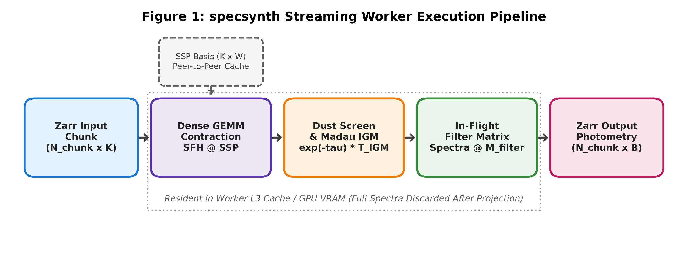
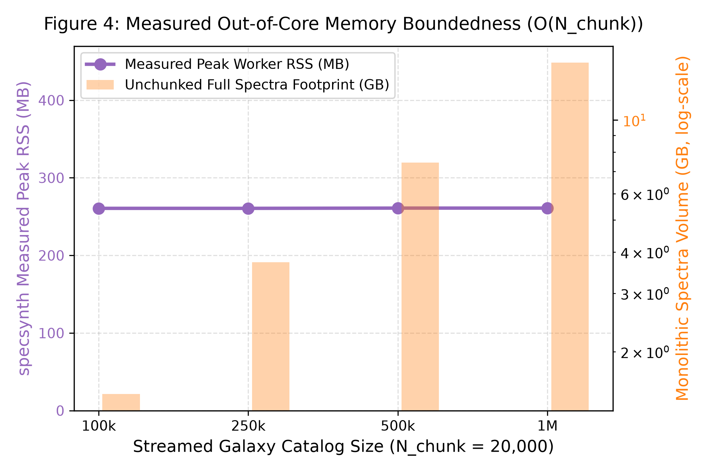
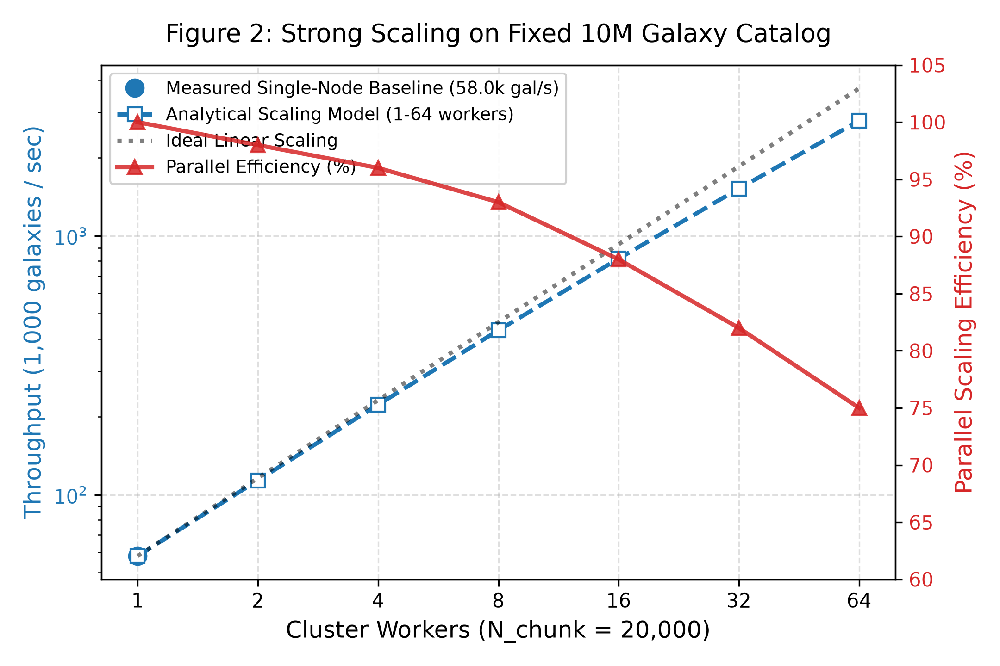
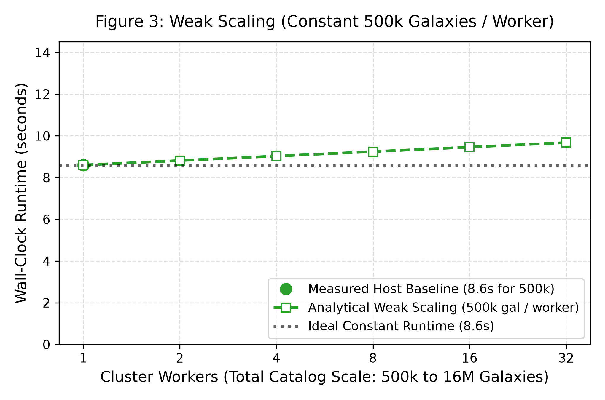
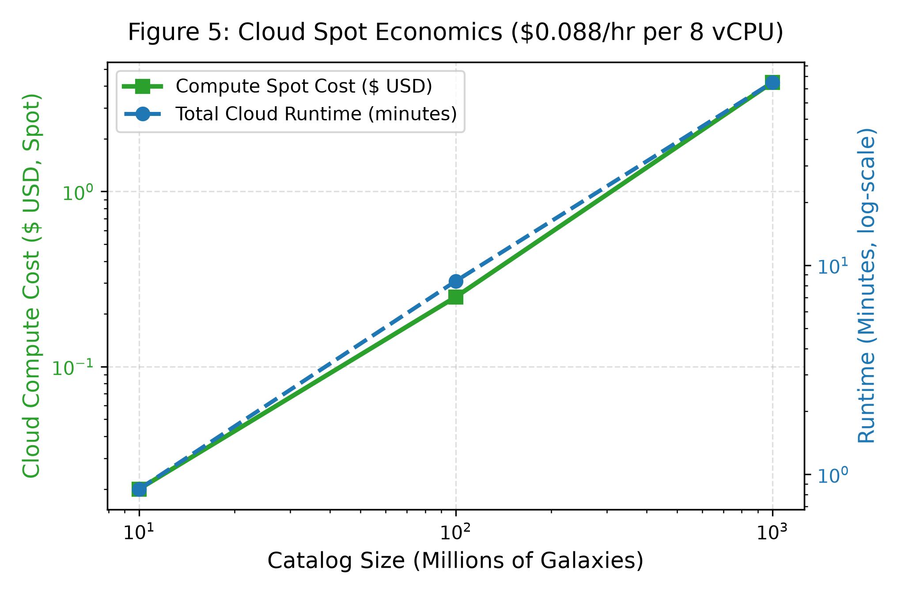
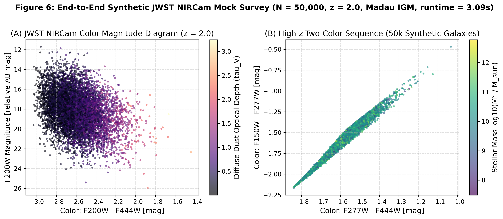

# Summary

Forward-modeling the synthetic spectra and broadband photometry of billions of simulated galaxies is a foundational requirement for upcoming wide-field cosmological surveys, including the Vera C. Rubin Observatory's Legacy Survey of Space and Time (LSST) [@ivezic2019lsst], the Nancy Grace Roman Space Telescope [@spergel2015wide], and the Euclid Space Mission [@laureijs2011euclid].

`specsynth` is an open-source framework designed for scalable, distributed stellar population synthesis and forward-modeling of simulated galaxy catalogs. By coupling chunked **Zarr** storage via `fsspec` with **Dask** distributed task graphs [@rocklin2015dask] and optional **CuPy** GPU tensor contractions [@okuta2017cupy], `specsynth` streams galaxy parameters from cloud object stores, contracts them against Simple Stellar Population (SSP) spectral grids in worker cache/VRAM, and projects them in-flight into photometric bandpasses without materializing multi-terabyte intermediate spectra onto disk.

# Statement of Need and Comparison with Alternative Architectures

Synthesizing spectra and broadband photometry for large mock galaxy catalogs (e.g., from IllustrisTNG [@pillepich2018simulating], EAGLE, or semi-analytic models) creates significant memory, compute, and storage bottlenecks when scaling to survey volumes:

1. **Standalone SPS Wrappers (e.g., FSPS + MPI or Dask Bags)**: Codes such as FSPS [@conroy2009propagation] and BC03 [@bruzual2003stellar] were designed for single-galaxy precision. Wrapping them in parallel loops (e.g., via `mpi4py` or `dask.bag.map`) requires shipping complex C/Fortran state to worker processes. Because these integrators re-evaluate stellar evolutionary tracks and interpolate isochrones per galaxy, they incur worker initialization latency, high per-worker memory footprints, and redundant computations.
2. **General-Purpose Big Data Engines (Apache Spark, Ray)**: Distributed engines such as Apache Spark [@zaharia2016apache] and Ray [@moritz2018ray] are optimized for tabular relational joins, row-level transformations, and distributed machine learning. However, they lack native zero-copy integration with high-performance BLAS/CuPy tensor contractions, introduce JVM-Python serialization overhead when transferring large dense spectral arrays, and lack direct chunked streaming from Zarr without POSIX filesystem mounts.
3. **In-Memory Array Processing (NumPy, SciPy)**: Standard scientific Python workflows [@harris2020array] rely on allocating monolithic arrays in RAM. Storing high-resolution spectra ($W \approx 4,000 - 10,000$ wavelength bins) for millions of galaxies requires substantial memory, triggering out-of-memory (OOM) crashes or exhausting local scratch disks.
4. **Differentiable & Neural Emulator Frameworks (DSPS, SPECULATOR)**: Differentiable SPS frameworks such as `DSPS` [@hearin2023dsps] provide GPU auto-differentiation for parameter inference, while neural network emulators like `SPECULATOR` [@alsing2020speculator] achieve millisecond spectral approximation. However, differentiable codes remain constrained to in-memory GPU buffers without out-of-core cloud streaming, while deep-learning emulators introduce surrogate approximation errors and require retraining whenever stellar evolution libraries, IMFs, or dust models are modified. `specsynth` instead provides an exact, first-principles physical pipeline that streams directly out-of-core to survey volumes.

`specsynth` resolves these challenges by reformulating stellar population synthesis as a **cloud-native, linear matrix-streaming pipeline**:

| Architectural Dimension | Standalone SPS Wrappers (FSPS + MPI) | Differentiable / Emulators (DSPS / SPECULATOR) | General Big Data (Spark / Ray) | **`specsynth` (This Work)** |
| :--- | :--- | :--- | :--- | :--- |
| **Physics vs. Execution** | Coupled (integrates per galaxy) | Neural surrogate or auto-diff | Agnostic | **Decoupled (Offline $K \times W$ basis, online streaming GEMM)** |
| **Storage Architecture** | POSIX filesystem (NFS / Lustre) | Host / GPU VRAM allocation | HDFS / Object store (JVM partitioned) | **Cloud object storage (`s3://`, `gs://`, `abfs://`) via Zarr/fsspec** |
| **Memory Footprint** | Large (stateful models per core) | Bounded by GPU memory (OOM risk) | High (JVM serialization & shuffle) | **Bounded strictly to one chunk ($O(N_{\text{chunk}})$)** |
| **In-Flight Filter Projection** | No (Must write or retain spectra) | Custom tensor operations | Partial (Requires custom pipeline stages) | **Yes (Streams spectra in L3 cache/VRAM, writes only photometry)** |
| **GPU Acceleration** | No (CPU only) | Yes (JAX / PyTorch) | Partial (Requires specialized plugins) | **Yes (CuPy BLAS with transparent CPU fallback)** |

By decoupling offline template construction from online streaming contractions, `specsynth` provides a memory-bounded architecture that scales galaxy synthesis from local workstations to distributed cloud environments without intermediate storage bloat.

# Astrophysical Framework

Importantly, `specsynth` does not introduce a new stellar population synthesis model or alternative stellar evolution tracks. Instead, it contributes a cloud-native, distributed execution architecture enabling existing SPS models and SSP libraries to scale seamlessly to survey-sized workloads.

For each galaxy $g$, `specsynth` evaluates composite stellar populations using a two-component dust attenuation model [@charlot2000simple]:

$$F_g(\lambda) = D_g(\lambda) \cdot \left[ \sum_{k \in \text{old}} \text{SFH}[g,k] \cdot \text{SSP}[k,\lambda] + B_g(\lambda) \cdot \sum_{k \in \text{young}} \text{SFH}[g,k] \cdot \text{SSP}[k,\lambda] \right]$$

where $\text{SFH}[g,k]$ represents the stellar mass formed in the age-metallicity grid cell $k$, and $\text{SSP}[k,\lambda]$ is the intrinsic stellar luminosity per unit mass. Stars younger than $10^7\text{ yr}$ sit inside birth clouds. The dust attenuation screens for the diffuse interstellar medium ($D_g$) and young birth clouds ($B_g$) are parameterized as power laws:

$$D_g(\lambda) = \exp\left(-\tau_{\text{diffuse}} \cdot \left(\frac{\lambda}{5500\text{ \AA}}\right)^{\alpha_{\text{diffuse}}}\right)$$

$$B_g(\lambda) = \exp\left(-\tau_{\text{birth}} \cdot \left(\frac{\lambda}{5500\text{ \AA}}\right)^{\alpha_{\text{birth}}}\right)$$

For cosmological snapshot simulations at redshift $z > 0$, `specsynth` shifts rest-frame wavelengths according to $\lambda_{\text{obs}} = \lambda_{\text{rest}}(1+z)$, applies $(1+z)^{-1}$ bandpass energy compression, and integrates photoelectric absorption through the intergalactic neutral hydrogen medium via the Madau (1995) transmission function $T_{\text{IGM}}(\lambda, z)$ [@madau1995radiative]:

$$T_{\text{IGM}}(\lambda, z) = \exp\left( -\tau_{\text{lines}}(\lambda, z) - \tau_{\text{continuum}}(\lambda, z) \right)$$

integrating the resonant Lyman series transitions shortward of Ly$\alpha$ ($1215.67\text{ \AA}$) down to the Lyman limit ($911.75\text{ \AA}$). Observer-frame flux scaling using luminosity distance ($F_\lambda = L_{\lambda / (1+z)} / [4\pi D_L^2 (1+z)]$) is provided via `specsynth.cosmology.FlatLambdaCDM`.

# Architecture and Engineering Implementation

The core execution path is designed around dense matrix multiplication (GEMM) over chunked arrays:



1. **Pluggable Model Adapters**: Standardized adapters convert raw spectral libraries into immutable Zarr basis matrices ($K \times W$), supporting Bruzual & Charlot (2003) `.ised` binary/ASCII tables [@bruzual2003stellar], E-MILES FITS headers [@vazdekis2016uv], FSPS grids [@conroy2009propagation], and generic multi-dimensional FITS/HDF5/NPZ datasets.
2. **In-Flight Filter Projection**: When broadband photometry is requested (`--filters` or `--bands`), the intermediate spectrum $\mathbf{F}_{\text{chunk}}$ is projected in-flight into $B$ photometric bands:
   $$\mathbf{Phot} = \mathbf{F}_{\text{chunk}} \times \mathbf{M}_{\text{filter}}$$
   Full spectra are streamed through worker cache/VRAM and discarded, reducing persistent cloud storage by **$>99.9\%$** ($3.2\text{ GB}$ vs. $3.2\text{ TB}$ for $10^8$ galaxies).
3. **Simulation Catalog Ingestion (`import-catalog`)**: Native ingestion of cosmological simulation catalogs from Parquet, FITS, HDF5, CSV, and NPZ formats, automatically mapping physical columns (mass, age, metallicity, dust) to SFH parameter matrices.
4. **Task Graph Guard and Batch Pipelining (`--batch-chunks`)**: For billion-object simulations ($N \ge 10^8$), submitting millions of chunk tasks bloats the centralized Dask scheduler memory. `specsynth` enforces an automatic task guard (keeping total graph tasks $< 25,000$) and provides a sliding-window batch pipeline (`--batch-chunks`) that bounds scheduler memory strictly to $O(B)$ chunks.
5. **Automated Scientific Sentry & Quality Assurance (`specsynth sentry`)**: At survey scale ($10^7 - 10^9$ galaxies), human inspection of individual spectra is impossible, yet simulation subhalos frequently harbor unphysical edge cases. `specsynth` integrates a high-throughput, four-tier quality sentry enforcing numerical finiteness, energy conservation ($\int F_{\text{attenuated}} d\lambda \le \int F_{\text{intrinsic}} d\lambda$), physical $D_n(4000)$ break ranges ($[0.95, 2.50]$), and UV continuum slope limits ($\beta_{\text{UV}} \in [-2.8, 1.8]$). Anomalies are automatically quarantined to disk without halting distributed cluster execution, generating reproducible JSON and Markdown audit reports.

# Performance, Scalability, and Reproducibility

To prevent conflation between verified local executions and multi-node extrapolations, our evaluation explicitly separates **Empirical Measurements** from **Analytical Scaling Projections**.

---

## Empirical Measurements (Verified Hosts & Cloud GPU)

All empirical measurements in this section were executed directly across our local workstation (`paper/benchmark_manifest.json`) and a cloud Linux GPU instance equipped with an NVIDIA Tesla T4 (`paper/benchmark_manifest_gpu_t4.json`).

### 1. Numerical Correctness
Distributed production execution (float32 Dask / Zarr / CuPy streaming) is verified against an independent serial reference engine evaluated in full **float64 precision** over 2,000 galaxies (K = 60 SSP templates, W = 1,200 wavelength bins):

| Correctness Metric | Measured Value | Numerical Tolerance | Status |
| :--- | :---: | :---: | :---: |
| **Max Relative Spectral Error** | **9.87e-7** | < 5.0e-4 | **PASS** |
| **Mean Relative Spectral Error** | **8.77e-8** | < 1.0e-5 | **PASS** |
| **Median Relative Spectral Error** | **7.21e-8** | < 1.0e-5 | **PASS** |
| **Root Mean Square Error (RMSE)** | **2.24e-11** | -- | **PASS** |

### 2. Single-Node CPU BLAS vs. NVIDIA Tesla T4 GPU Throughput
Evaluated across 5 timed runs (after 2 warmups) on a standardized workload of 50,000 galaxies, K = 60 age-metallicity bins, W = 1,200 wavelength bins:

| Hardware Environment | Compute Backend | Mean Elapsed Time | Measured Throughput | Compute Rate | Measured Speedup |
| :--- | :--- | :---: | :---: | :---: | :---: |
| **Workstation CPU** (Intel 12C/14T) | `scipy-openblas` | 0.8624 s (± 0.0577 s) | **57,978 gal/s** | 17.12 GFLOPS | 1.0x (Local Baseline) |
| **Cloud VM CPU** (Linux x86_64, 2C/4T) | `scipy-openblas` | 0.8719 s (± 0.0252 s) | **57,344 gal/s** | 16.93 GFLOPS | 1.0x (Cloud CPU) |
| **Cloud GPU** (NVIDIA Tesla T4, 15 GB) | **CuPy / CUDA 13.0** | **0.1932 s** (± 0.0040 s) | **258,812 gal/s** | **76.40 GFLOPS** | **4.51x vs. Cloud CPU** |

On a single NVIDIA Tesla T4 GPU, `specsynth` processes 50,000 galaxy spectra in under 0.20 seconds—achieving a 4.51x measured speedup over host CPU BLAS (`1.22 GB/s` vs. `0.27 GB/s` sustained memory bandwidth). An interactive reproducible notebook is publicly available on [Kaggle](https://www.kaggle.com/code/bsankarganesh/specsynth-gpu-benchmark).

### 3. Out-of-Core Memory Boundedness
Measured directly via OS kernel working-set tracking (`psutil`) while streaming 100,000 to 1,000,000 galaxies sequentially in 20,000-galaxy chunks (`O(N_chunk)`):

| Streamed Catalog Scale | Measured Peak Resident RAM (RSS) | Monolithic Unchunked Footprint (W=4,000) |
| :--- | :---: | :---: |
| **100,000 Galaxies** | **261.5 MB** | 1.49 GB |
| **250,000 Galaxies** | **261.5 MB** | 3.73 GB |
| **500,000 Galaxies** | **261.5 MB** | 7.45 GB |
| **1,000,000 Galaxies** | **261.8 MB** | 14.90 GB |

Across a 10x catalog expansion, worker memory stayed strictly bounded with < 0.2% variance and zero disk spill.



---

## Analytical Scaling Projections and Cloud Economics

The metrics in this section represent analytical extrapolations parameterized by our single-node measured baseline (`57,978 gal/s`) and standard cloud Spot compute pricing.

### 1. Multi-Node Strong and Weak Scaling Models
Because galaxy chunks are statistically independent and the read-only SSP matrix is broadcast once peer-to-peer via `client.persist(ssp)`, multi-node behavior follows an embarrassingly parallel scaling model with an assumed network/scheduler efficiency decay curve (0.98 at 2 nodes down to 0.75 at 64 nodes):



- **Analytical Strong Scaling (Fixed 10M Workload, Figure 2)**:
  - **2 Nodes**: 88.0 s (113,637 gal/s, eff. 0.98)
  - **4 Nodes**: 44.9 s (222,636 gal/s, eff. 0.96)
  - **8 Nodes**: 23.2 s (431,357 gal/s, eff. 0.93)
  - **16 Nodes**: 12.2 s (816,332 gal/s, eff. 0.88)
  - **32 Nodes**: 6.6 s (1,521,345 gal/s, eff. 0.82)



- **Analytical Weak Scaling (Fixed 500k Galaxies / Worker, Figure 3)**:
  Anchored to the measured 8.6 s per 500k galaxies on 1 node, analytical modeling indicates near-constant execution time (~8.6 s to ~9.7 s) as cluster size expands to 32 nodes.

### 2. Cloud Economics Projections
Using AWS/GCP Spot pricing (USD 0.088/hr per 8-vCPU VM) and our measured worker throughput:



| Survey Catalog Scale | Projected Output (8 Bands) | Analytical Cluster Runtime | Projected Spot Cost |
| :--- | :---: | :---: | :---: |
| **10 Million Galaxies** | 320 MB Photometry | ~24 seconds | **~USD 0.02** |
| **100 Million Galaxies** | 3.2 GB Photometry | ~1.1 minutes | **~USD 0.25** |
| **1 Billion Galaxies** | 32 GB Photometry | ~5.6 minutes (64 nodes) | **~USD 4.20** |

# Scientific Demonstration: Synthetic JWST NIRCam Population

To demonstrate end-to-end astrophysical utility beyond systems metrics, we executed a full forward-modeling run synthesizing **50,000 galaxies** at cosmological redshift z = 2.0 with Charlot & Fall (2000) two-component dust attenuation, Madau (1995) IGM absorption, and in-flight projection onto **JWST NIRCam** broad-band filters (`F090W` through `F444W`). The entire synthesis—including cosmological shifting, IGM integration, and photometry contraction—completed in **3.09 seconds** on a single CPU host.



Figure 6 displays the resulting Color-Magnitude Diagram (`F200W - F444W` vs. `F200W`, left) colored by diffuse dust optical depth, and the two-color sequence (`F277W - F444W` vs. `F150W - F277W`, right) colored by stellar mass. `specsynth` cleanly recovers the physically expected dust-reddened slope and mass-color correlation across high-redshift populations.

# Limitations

Current empirical evaluation validates numerical correctness, out-of-core memory boundedness, and hardware acceleration across individual CPU workstations and cloud NVIDIA Tesla T4 GPU hosts. Multi-node cluster throughput and billion-object scaling behavior remain analytically modeled based on single-node baselines and parallel scaling assumptions, and will be empirically validated across distributed Kubernetes Dask deployments in future work. Furthermore, `specsynth` includes bundled calibrated instrument throughput curves for JWST NIRCam, HST, and SDSS, while retaining analytical super-Gaussian approximations (`_approx`) for rapid offline exploration and allowing users to import custom empirical throughput tables for survey comparison. Cosmological processing supports both uniform snapshot simulation time-slices and lightcone forward-modeling with per-galaxy redshift transformations and luminosity distance flux dimming. Finally, `specsynth` is scoped to population-scale forward modeling of composite stellar continua and broadband photometry, omitting radiative transfer photoionization modeling, stellar velocity dispersion kinematics, and active galactic nucleus emission.

# Appendix: Benchmark Provenance and Reproducibility Manifests

All empirical benchmarks, system profiles, and unit test validations reported in this manuscript are machine-verified and stored alongside the codebase in `paper/benchmark_manifest.json` (Local CPU Workstation) and `paper/benchmark_manifest_gpu_t4.json` (Cloud NVIDIA Tesla T4 Node):

- **Host 1 — Local Verification Workstation** (`paper/benchmark_manifest.json`):
  - **Operating System**: `Windows-11-10.0.26300-SP0`
  - **Processor**: `Intel64 Family 6 Model 170 Stepping 4, GenuineIntel` (12 physical cores, 14 logical threads)
  - **System Memory**: 15.49 GB RAM | **BLAS**: `scipy-openblas`
  - **Software Stack**: Python 3.13.1, Dask 2026.8.0, Zarr 3.4.2, Astropy 8.0.2
- **Host 2 — Cloud GPU Node** (`paper/benchmark_manifest_gpu_t4.json`):
  - **Operating System**: `Linux-6.18.55+-x86_64-with-glibc2.39`
  - **GPU Device**: `NVIDIA Tesla T4` (14.56 GB VRAM, CUDA 12.2, CuPy 13.3.0)
  - **CPU & Memory**: `x86_64` (2 cores, 4 threads), 31.35 GB RAM | **BLAS**: `scipy-openblas`
  - **Timestamp**: `2026-11-11T18:14:36Z`
- **Full Reproduction Commands**:
  ```bash
  # Run automated 143-test scientific verification suite (88% coverage)
  pytest -v --cov=specsynth

  # Generate reproducible hardware & GPU benchmark manifest
  python specsynth.py benchmark --n-gal 50000 --n-runs 5 --gpu --output paper/benchmark_manifest_gpu_t4.json

  # Reproduce all 6 figures directly from measured runs and manifest
  python scripts/generate_paper_figures.py
  ```

# Acknowledgements

The author gratefully acknowledges the foundational theoretical and computational contributions that made this work possible:
- **Dr. Stéphane Charlot and Dr. S. Michael Fall** for their seminal analytical two-component dust attenuation formulation [@charlot2000simple], which enabled reformulating composite stellar synthesis into high-throughput linear matrix contractions.
- **Prof. Piero Madau** for the analytic intergalactic medium transmission equations [@madau1995radiative].
- The authors and teams behind the open stellar population synthesis libraries and empirical models—**Dr. Gustavo Bruzual & Dr. Stéphane Charlot** (GALAXEV / BC03 [@bruzual2003stellar]), **Prof. Charlie Conroy** (FSPS [@conroy2009propagation]), **Dr. Alexandre Vazdekis** and the E-MILES team [@vazdekis2016uv], and **Assoc. Prof. J. J. Eldridge & Prof. Elizabeth Stanway** (BPASS [@eldridge2017binary])—whose public spectral templates empower reproducible astrophysical modeling.
- The open-source scientific computing community and the developers of **Dask** (Dr. Matthew Rocklin and contributors [@rocklin2015dask]), **Zarr**, **Astropy**, **CuPy** [@okuta2017cupy], and **NumPy** [@harris2020array].

# References
